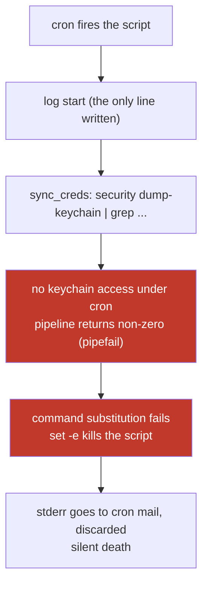

# Cron job that looked untriggered, actually a script dying silently

## Symptom
`~/bin/cc-ping.sh` — a scheduled script that starts a headless Claude session as a keepalive — "hasn't fired for days". No errors anywhere, no session visible in tmux, and the intuitive read is that cron is not running.

## Reproduction
Scheduled by crontab on macOS:

```
0 6,11,16,21 * * * /Users/kelsonqu/bin/cc-ping.sh
```

Reproduces at every scheduled time since the evening of 2026-06-20: the script starts, exits immediately, and leaves no trace of an error.

## Investigation timeline

1. Suspect cron itself first:

   ```bash
   crontab -l
   tail -60 ~/.cache/cc-ping.log
   ```

   Key output: the crontab entry is still there, and the log carries `===== start session=... =====` at 6, 11, 16 and 21 every day. ==cron has been firing all along==; "it never triggered" was an illusion. The real anomaly is elsewhere: before 6-20 every round logged a complete start → ready → done, and after `21:00` on 6-20 every round has **only the start line**, with everything after it missing.

2. Narrow the interval in which it dies. The first code after the start line that must write to the log is inside `sync_creds` — all three branches, success, failure and not-found, call `log` — and after that comes `dump_screen "after-launch"`, which appends unconditionally. Neither appears in the log, so the script dies inside `sync_creds`, and dies without a sound: the old script never routed stderr to disk, and cron discarded the mail.

3. Read `sync_creds` and find the lethal combination. The script opens with `set -euo pipefail`, and the function contains:

   ```bash
   result="$(security dump-keychain 2>/dev/null \
     | grep -oE '"Claude Code-credentials[^"]*"' \
     | ... | sort -t$'\t' -k1,1nr | head -n1)"
   ```

   Under cron there is no GUI security session, so `security dump-keychain` cannot reach the keychain and fails; and even when it can, `grep` returns 1 whenever nothing matches. Under `pipefail` either case makes the whole pipeline non-zero, the command-substitution assignment fails with it, and `set -e` kills the entire script — all of this before `tmux new-session`, so nothing ever launched.

4. Verify the fix, described below. Syntax check first, then a full run in the same minimal environment cron uses:

   ```bash
   bash -n ~/bin/cc-ping.sh
   env -i HOME="$HOME" PATH="<PATH from crontab>" SHELL=/bin/bash ~/bin/cc-ping.sh
   ```

   The log shows the complete chain, exit code 0:

   ```
   [2026-07-07T13:33:12] ===== start session=cc-ping-1783456392 =====
   [2026-07-07T13:33:12] synced freshest keychain credential (exp=...) -> ~/.claude/.credentials.json
   [2026-07-07T13:33:27] claude is ready, sending message
   [2026-07-07T13:33:45] ===== done =====
   ```

5. Verify the completely-unavailable-keychain path on its own: a minimal reproduction substituting `false` for `security` confirmed that under `set -euo pipefail` the script now takes the WARN branch, keeps going, and exits normally.

   > Note: the keychain happened to be reachable during this round of testing — `env -i` clears environment variables, not the GUI security session — so step 4 exercised the success branch, and the failure branch is covered by the minimal reproduction in step 5.



## Root cause
==Under `set -euo pipefail`, the keychain pipeline in `sync_creds` is guaranteed to return non-zero in a cron environment — `security` fails with no GUI session, or `grep` matches nothing — the command-substitution assignment fails, `set -e` fires, and the script is killed before it ever starts tmux. stderr was never written to disk, so the whole thing presented as "cron isn't triggering".==

## Fix
Three changes in `~/bin/cc-ping.sh`:

- `cc-ping.sh:11`: `exec 2>>"$LOG"` — all stderr goes into the log, so future failures are no longer silent.
- `cc-ping.sh:51`: `|| true` on the end of the keychain pipeline — missing credentials take the WARN branch instead of crashing.
- `cc-ping.sh:74`: the call site becomes `sync_creds || log "WARN: ..."` — calling a function with `||` disables `set -e` inside the function body, so no internal error can kill the script again, and Claude falls back to the existing credentials file.

Why not simply drop `set -euo pipefail`: the rest of the script, tmux and send-keys, still wants to fail fast. Only the best-effort credential sync needs tolerance, so the exemption stays local to that one section.

## Lessons
- "The scheduled job didn't fire" first has to be split into **the schedule never happened** and **the script died silently**; whether a start marker is in the log tells the two apart in a second. On where to put that log line, see [[log-placement]].
- `set -e` plus command substitution plus `pipefail` is the classic silent-death combination: in `var="$(a | b)"` any non-zero link kills the script, and that includes the entirely normal case of `grep` returning 1 on no match. See [[command-substitution-failure-kills-script-under-set-e]].
- Put `exec 2>>"$LOG"` ahead of the first line of business logic in a cron script, or every error ends up in cron mail and gets thrown away.
- Simulate a cron script with `env -i HOME=... PATH=<PATH from crontab>`, but note that macOS keychain access follows the security session rather than environment variables. `env -i` cannot simulate "keychain unreachable", so that path needs its own minimal reproduction.

## Related
- [[pipefail]]
- [[log-placement]]
- [[systematic-troubleshooting]]
- [[command-substitution-failure-kills-script-under-set-e]]
