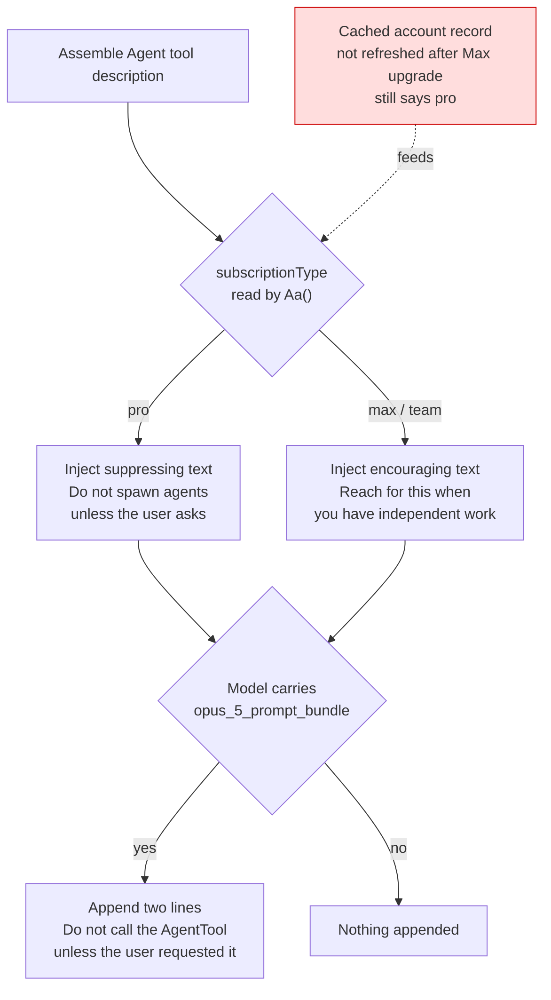

# subagents never spawn on their own, every local config is correct, and the root cause is a stale cached subscription tier

## Symptom

Asked "does my model spawn subagents by default?" The observed behaviour: it never dispatches one on its own initiative. Nothing under `~/.claude/` explains it, yet this passage is sitting in my context:

```
**Do not spawn agents unless the user asks.** Each spawn starts cold and
re-derives context you already have — it's the expensive path on this plan.
```

`this plan` is the only lead in it: the passage depends on subscription tier, and the user did not write it.

## Reproduction

Every session. No particular action required — it is there from startup.

## Investigation timeline

1. **Suspect my own config first.** Checking settings:

   ```bash
   grep -nE 'model|SUBAGENT|effort' ~/.claude/settings.json
   ```

   Output: `50: "model": "opus"` and `220: "effortLevel": "xhigh"`. No `CLAUDE_CODE_SUBAGENT_MODEL`, no `Agent(...)` permission rule, no hook. Incidental discrepancy: memory records the main model as fable when it is actually opus, but that is a separate matter.

2. **Search the text globally** to confirm it isn't mine:

   ```bash
   grep -rn "Do not call the AgentTool" ~/.claude/
   ```

   Zero results. It can only come from the CLI itself.

3. **Locate the binary**:

   ```bash
   which -a claude          # → /Users/kelsonqu/.local/bin/claude
   ls -la ~/.local/bin/claude  # → symlink to versions/2.1.220
   file 2.1.220             # → Mach-O 64-bit executable arm64
   ```

   Not a `cli.js` — a compiled native binary. But the JS source is still inside it as strings:

   ```bash
   strings -n 20 2.1.220 | grep -i "Do not call the AgentTool"
   ```

   Hit. Source confirmed.

4. **Detour one: grabbing context straight out of the binary.** To see the condition guarding that string:

   ```bash
   grep -a -o -E ".{280}\*\*Do not spawn agents unless the user asks" 2.1.220
   ```

   `grep: maximum repetition exceeds 255`. The `{n}` limit in BRE/ERE is 255.

5. **Detour two: dropping to 250 doesn't help either.** `.{250}` stops erroring, but the command ran the full 120 seconds and got moved to the background — a backtracking regex against tens of megabytes of binary is unusably slow.

6. **Change of approach: dump first, grep after.** Every query after this step returns in seconds:

   ```bash
   strings -n 6 2.1.220 > "$TMPDIR/cc.strings"   # 394254 lines
   grep -n -B4 "Do not spawn agents unless" "$TMPDIR/cc.strings"
   ```

   Which yields the assembly logic:

   ```js
   f=Cq()==="default",
   m=Aa()==="pro"?`
   **Do not spawn agents unless the user asks.** ...`:""
   ```

   `m` is the slot spliced into the Agent tool description. **The condition is subscription tier equal to `pro`.**

7. **Dig into `Aa()`**:

   ```js
   function Aa(){if(f3i())return p3i();if(!zb())return null;
                 let e=ms();if(!e)return null;return e.subscriptionType??null}
   function f3i(){return fXt&&Ibc!==null&&!1}
   ```

   The trailing `&&!1` in `f3i()` makes it constantly false — a dead branch. So `Aa()` amounts to reading `subscriptionType` out of the cached account record.

8. **A second gate turns up, unrelated to subscription.** The two lines at the end of the file, "Do not call the AgentTool" and "Do not use workflows", are a separate mechanism:

   ```js
   ttp=["Do not call the AgentTool unless the user requested it",
        "Do not use workflows or deep-research unless the user requested it"]
   function tXn(e){if(e===void 0)return!1;
                   if(LN(lo(e),"opus_5_prompt_bundle")!==!0)return!1;
                   return!Ke(nug,!1)}
   nug="tengu_fennel_godwit"
   ```

   It only checks whether the model carries `opus_5_prompt_bundle`, and injects on any plan. Telemetry codename `heron_brook`. The same bundle also contains the `# Delivering work` and `# Corrections` sections — near word-for-word matches for the recommended wording in the official Opus 5 prompting guide, so this is official tuning rather than a downgrade aimed at me.

9. **Trying to read the account plan directly, blocked**:

   ```bash
   grep -o '"subscriptionType":"[^"]*"' ~/.claude/.claude.json   # empty
   grep -o '"subscriptionType":"[^"]*"' ~/.claude/.credentials.json
   # → Access denied: '.credentials.json' is protected by default patterns
   ```

   A hook blocks the credentials file, which is correct behaviour. That route is closed, leaving only inference.

10. **Establish that the `pro` branch is unique**, ruling out the possibility that other tiers inject the same text:

    ```bash
    grep -c "Do not spawn agents unless the user asks" "$TMPDIR/cc.strings"   # → 1
    grep -o -E 'Aa\(\)==="(max|team|enterprise)"\?' "$TMPDIR/cc.strings"      # → empty
    ```

    One occurrence in the entire binary, and no max/team branch. The text is in my context ⇒ `Aa()` is returning `"pro"` right now.

11. **But the user says the account is Max, at $200.** Only one of those can be true. Two possibilities remain: the active account is not that Max account (this user runs claude1/2/3 as multiple accounts, with account2 symlinked into `~/.claude`), or the cached `subscriptionType` was never refreshed after the upgrade. Both point at the same action — log in again.

12. **Re-check after logging back in.** The binary is unchanged (`grep -c` is still 1, the text still at line 351940), but the `m` slot in my context is empty and a different branch has taken its place (line 351949):

    > Reach for this when the task matches an available agent type, **when you have independent work to run in parallel** ...

    From "don't spawn" to "spawn when it fits". The second gate's two lines are still there, as expected.

## Root cause

Two independent gates stack, and the left-hand hop is the broken one:



==The `subscriptionType` in Claude Code's cached OAuth account record was still the pre-upgrade `pro`, while every local config file was correct.== Working from that stale value, the binary injected the Pro-only suppression text, which shows up behaviourally as "subagents never spawn on their own" with no configuration anywhere that can account for it.

## Fix

Log in again. No code or config change of any kind.

`"model": "opus"` at `~/.claude/settings.json:50` stays as it is — the official docs describe Opus 5 as a step-change on long-horizon agentic work at half the cost of Fable 5, so the premise behind "Fable as orchestrator" no longer holds.

## Lessons

- **Wording like `this plan`, `your plan`, or `on this tier` is a strong lead.** It means the passage is assembled dynamically from account state, and the identity cache is worth checking directly instead of digging through more config.
- **Correct config ≠ correct runtime state.** This is a variant of [[config-on-disk-is-not-config-in-effect]], but a better-hidden one: that note is about a file being written but not loaded, whereas here both the file and the load were fine and the failure was in the cached runtime **identity**. The right order is `/status` first, to see the account and plan the runtime believes it has, and only then read code.
- Binary-spelunking technique noted separately: [[dump-then-grep-strings-from-binaries]].
- Inference still works when the credential itself is unreadable: establish that the branch producing a given piece of text is globally unique with no sibling branches, and the presence of the text proves the branch condition held, without ever reading the value.

## Related
- [[config-on-disk-is-not-config-in-effect]]
- [[dump-then-grep-strings-from-binaries]]
- [[2026-07-25-trimming-claude-md-and-splitting-agents-index]]
- [[2026-07-07-unifying-dual-account-claude-config]]
- [[MCP]]
