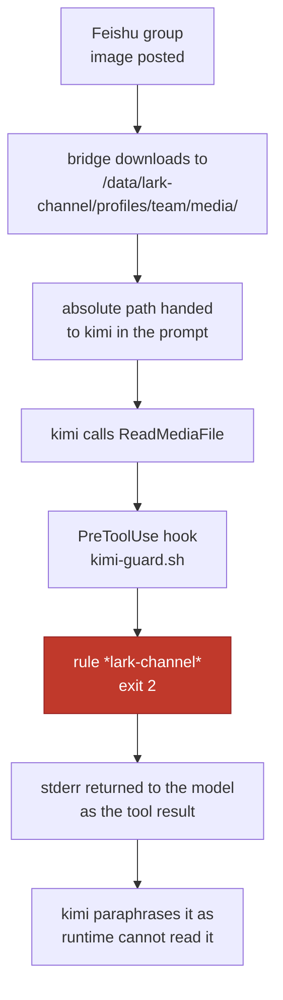

# Posting an image to a Feishu group, kimi says "the media directory is off limits to my runtime", and the root cause is my own blanket guard rule

## Symptom

Post a screenshot to a Feishu group and the bot replies:

> Sorry, I can't view this image — the media directory where the bridge stores attachments is unreadable from my runtime, so the image content never reaches me. Please send it another way: if the image is text, paste or type the text directly.

That sentence is actively misleading. It sounds like a sandbox or container mount problem, and it isn't.

## Reproduction

Every time, for any image sent to `lark-team-bot` (lark-channel-bridge plus kimi, running in docker). Text messages work fine; `.md` attachments are equally unreadable.

## Investigation timeline

1. **Find out where attachments actually live.** `lark-channel-bridge`'s README has a table of state directories:

   ```bash
   grep -n -A8 "附件" /opt/homebrew/lib/node_modules/lark-channel-bridge/README.zh.md
   ```

   `README.zh.md:232` names `~/.lark-channel/profiles/<profile>/media/` as the attachment cache.

2. **Suspect file permissions.** A quick look:

   ```bash
   ls -la ~/.lark-channel/profiles/claude/media/
   ```

   Directories 755, files 644, all readable. Not a POSIX permission problem.

3. **Detour one: assuming it's a Claude Code path boundary.** The media directory is outside the workspace cwd, and `additionalDirectories` in `~/.claude/settings.json` lists only `/tmp` and `~/Desktop`. There is a known issue matching that shape (`anthropics/claude-code#29013`: `additionalDirectories` does not authorise the Read tool, EPERM).

   But reading one of the local media jpgs with the Read tool displays the image just fine. Checking the bridge's own session transcripts:

   ```bash
   grep -l "profiles/claude/media" ~/.claude/projects/-Users-kelsonqu--lark-channel-workspaces-claude-default/*.jsonl
   ```

   Across four sessions, every `Read` of an image produced a normal `tool_result` of `{"type":"image","source":{"type":"base64",...}}`. ==This path has worked the whole time; the problem is not on the Claude Code side.==

4. **Detour two: assuming it's the file extension.** The media directory has a few `.bin` files mixed in, suggesting the bridge falls back to `.bin` when it can't determine a MIME type, which would leave the image reader unable to identify them.

   ```bash
   cd ~/.lark-channel/profiles/claude/media && for f in *.bin; do file -b "$f"; done
   ```

   All three are `Zip archive data` — pptx files, not images. The images were already `.jpg`. Ruled out.

5. **Back to the original hint, "go look at kimi's docker".** Everything so far had examined the local Claude bridge, but the failure is coming from a different one:

   ```bash
   docker ps -a --format '{{.Names}}\t{{.Status}}'
   ```

   `lark-team-bot  Up 26 hours`. That container runs the same bridge with kimi swapped in for the agent — `kimi-as-claude.mjs` disguises kimi as the `claude` binary to fool the bridge. In the `Dockerfile`, `LARK_CHANNEL_HOME=/data/lark-channel` and `WORKDIR=/data/workspace`.

6. **Read the guard.** `kimi-guard.sh` is the PreToolUse hook registered in kimi's `config.toml`. Around `kimi-guard.sh:72`:

   ```sh
   case "$P" in
     *lark-channel*)
       block "blocked: /data/lark-channel is the bridge's encrypted keystore, ..." ;;
   ```

   One substring rule covering the entire tree — and the attachment cache sits under that tree, at `profiles/<p>/media/`.

7. **Get the decisive evidence.** The guard's `block()` writes a log:

   ```bash
   docker exec lark-team-bot sh -c 'grep media /data/kimi-guard.log | tail -3'
   ```

   ```
   2026-08-11T08:33:05Z  blocked: ... off limits
     tool_name:"Bash"  command:"ls -la /data/lark-channel/profiles/team/media/c5698cbe….jpg"
   2026-08-11T08:33:17Z  blocked: ... off limits
     tool_name:"ReadMediaFile"  path:"/data/lark-channel/profiles/team/media/c5698cbe….jpg"
   2026-08-13T19:15:53Z  blocked: ... off limits
     tool_name:"Bash"  command:"file /data/lark-channel/profiles/team/media/54b2e413….jpg"
   ```

   The last entry's timestamp is the image I had just sent. kimi probes the type with Bash `file` first, gets blocked, and gives up. The two 08-11 entries are more complete: after `ls` was blocked, it switched to the correct `ReadMediaFile` within 12 seconds and was blocked again.

## Root cause

==The bridge downloads chat attachments into the same tree as the encrypted keystore, and the guard shuts down that entire tree with a single `*lark-channel*` substring rule. The attachments go down with it.==

The timeline lines up too. `kimi-guard.sh`'s own comments record that before 2026-08-10 the hook's matcher was `Bash` only, so Read / Write / Edit never entered the guard at all and images were viewable up to that point. The day the matcher widened to `Bash|Edit|Write|Read`, this batch of path rules — written for *Bash command strings* — started applying to *individual file paths*. The blast radius changed and nobody re-reviewed them.

One more detail: `ReadMediaFile` does not match the guard's precise `Read|Edit|Write)` case. It falls all the way through to the catch-all rule that matches the whole event JSON, and gets blocked there. The matcher is an unanchored regex (`new RegExp("Bash|Edit|Write|Read").test(name)`), so `ReadMediaFile` gets in and then nothing handles it.



## Fix

Three files, commits `fff71f0` and `bbbfd21`.

**From `kimi-guard.sh:68`** — add `ReadMediaFile` to the file-tool branch (its input field is also called `path`, confirmed against the zod schema in the kimi binary), then grant exactly one precise exemption, to read-only tools:

```sh
case "$TOOL:$P" in
  Read:*/lark-channel/profiles/*/media/*|ReadMediaFile:*/lark-channel/profiles/*/media/*)
    case "$P" in *..*) ;; *) exit 0 ;; esac ;;
esac
```

The exemption covers the media directory level and nothing else, paths containing `..` do not qualify, and `Write` / `Edit` are still blocked. Bash still cannot touch that tree at all — it is arbitrary shell and string analysis cannot contain it, as the guard's own comments say — but the block message now points the way, telling it to use `ReadMediaFile` instead, because kimi's habit is to probe with `file` or `ls` first and abandon the whole attempt once it sees "off limits".

**`AGENTS.md:285`** — the prose said the whole `/data/lark-channel` tree was off limits; added a sentence noting the media exception. Out of sync, kimi may read the docs and not even try.

**`entrypoint.sh`** — while there, checked whether GC was needed. Conclusion: attachments don't need it, kimi's session directory does.

| Directory | Growth | Cap |
|-|-|-|
| `profiles/*/media/` | 1.2 MB / 6 days | yes, `enforceCacheMaxBytes` 512 MB |
| `.kimi-code/sessions/` | 13 MB / 5 days | none |

The bridge's `cacheMaxBytes` runs on every attachment received, so capacity is covered. The `cacheTtlMs: 24h` in the config is read once at parse time and never consumed anywhere, so time-based cleanup does not exist at all. I left it alone — there is no disk pressure, and implementing it would make "that image from yesterday" unreadable, which is a net negative.

Session directories are one per session and never reclaimed, so cleanup goes at startup:

```sh
find "$S" -mindepth 2 -maxdepth 2 -type d -name 'session_*' -mtime +30 -prune -exec rm -rf {} +
```

30 days matches the expiry of the shim's `.kac-tier` marker — once that marker expires, resume stops working anyway, so everything deleted was already unreachable. The image has no cron, so everything is scheduled at startup.

After `docker compose build && up -d`, verification by feeding events to the guard directly inside the container: `ReadMediaFile` on a real attachment exits 0, `Read` on the keystore config exits 2, `Bash file` on the same image exits 2.

## Lessons

- ==When an agent says "I don't have permission to read X", the reason it gives is a paraphrase, not the original error.== Go straight to the hook or guard log for the block record — `tool_name` and the full `tool_input` are both in there, and it is much faster than guessing from the agent's phrasing. See [[check-hook-logs-when-an-agent-claims-no-permission]].
- A deny rule written as a path substring assumes everything under that tree is sensitive. A cache directory sharing a `HOME` with credentials is a common layout, so `ls` the tree before writing the rule.
- Widening the set of tools a hook matcher applies to changes what the existing rules mean: a match written for a *shell command string* has a completely different blast radius when applied to a *single file path*.
- An unanchored matcher regex pulls in tool names you did not intend (`Read` catching `ReadMediaFile`), and if the script dispatches internally on exact cases, you get a gap where a tool gets in and nothing catches it.

## Related
- [[widening-a-hook-matcher-revisits-every-rule]]
- [[verify-hooks-fire-before-trusting-them]]
- [[check-hook-logs-when-an-agent-claims-no-permission]]
- [[TTL]]
- [[GC]]
- [[2026-07-07-unifying-dual-account-claude-config]]
