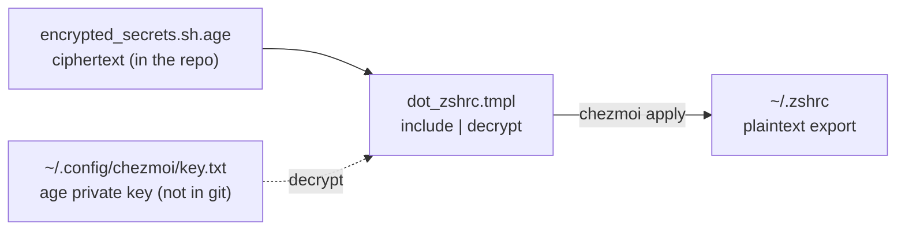

# Moving plaintext API keys in the chezmoi repo to age encryption

## Background and constraints

A routine `chezmoi status`, meant to sync local edits back into the dotfiles source repo, showed 5 files newer locally than in the source while the source repo's git tree was clean. `chezmoi diff` showed `.zshrc` had picked up a local `APIROUTER_API_KEY` line, and that turned up something else along the way: the source repo's `dot_zshrc` had been storing `DEEPSEEK_API_KEY` and `ODYSSEUS_API_TOKEN` in plaintext for a long time.

The repo `github.com:KaichenQu/dotfiles.git` is private (confirmed with `gh repo view`), so this was not an active public leak, but plaintext keys in git history are a standing hazard.

Constraints:

- One macOS machine, and no appetite for installing a pile of tooling over this.
- The keys have to travel with the dotfiles and be recoverable on a new machine.
- Most of `.zshrc` is ordinary config and only three lines are keys; turning the whole file into unreadable ciphertext and losing its diff is not acceptable.

## Candidate options

Three genuinely viable directions.

### Option A: macOS keychain plus a chezmoi template

- Approach: store the keys in the login keychain (`security add-generic-password`) and pull them in `dot_zshrc.tmpl` through chezmoi's built-in `keyring` function.
- Upside: nothing extra to install, native to the system.
- Cost: the keys do not travel with the repo, so a new machine means loading the keychain all over again; the keys themselves have no backup medium.

### Option B: age encryption

- Approach: `brew install age`, generate an age keypair, set `encryption = "age"` in chezmoi, let the keys enter the repo as ciphertext, and keep the age private key on the machine.
- Upside: the keys sync with the repo as ciphertext, and a new machine only needs the age private key to decrypt them; a first-class citizen in chezmoi.
- Cost: one more tool to install, and one more private key that has to be kept safe.

### Option C: split into `~/.zshrc.local` and have chezmoi ignore it

- Approach: `.zshrc` sources a local file, the keys move there, and `.chezmoiignore` excludes it.
- Upside: the least work, and the keys never enter git.
- Cost: the keys fall outside chezmoi's management and have to be rebuilt by hand on a new machine; locally they are still plaintext.

## Decision

==Option B, age encryption.== The deciding constraint is "the keys have to travel with the repo and be recoverable on a new machine": A and C both leave the keys on a single machine with nothing to sync or back them up, while B puts the ciphertext in the repo and asks only that one age private key be kept separately, which fits exactly. Installing one extra tool, `age`, is an acceptable price.

For the old keys already exposed in history, the choice was to rewrite history (`git filter-repo`) rather than issue new keys. The cost of that is under "Not done" below.

## Implementation

The point was to encrypt a few lines of a file and leave the rest alone, so `chezmoi add --encrypt` was not used — that would turn all of `.zshrc` into ciphertext. Instead the three `export` lines were pulled out into a standalone encrypted fragment that the template decrypts and splices back in at render time.

```bash
# 1. Tooling and keys
brew install age git-filter-repo
age-keygen -o ~/.config/chezmoi/key.txt    # private key, chmod 600, outside the source dir
# chezmoi.toml: encryption="age" + [age] identity/recipient(public key)

# 2. Encrypt the three keys into a single fragment
chezmoi encrypt secrets.sh > ~/.local/share/chezmoi/encrypted_secrets.sh.age

# 3. Templatize dot_zshrc: drop the three plaintext lines, append the decrypt
git mv dot_zshrc dot_zshrc.tmpl
# {{ include "encrypted_secrets.sh.age" | decrypt -}}

# 4. Check the render, then apply
chezmoi cat ~/.zshrc   # confirm the three keys decrypt correctly
chezmoi apply ~/.zshrc
```

Data flow at render time:



## Wrong turn: one missing pathspec voids the whole git add

After `git mv dot_zshrc dot_zshrc.tmpl`, out of habit both the old and the new name went into the same add:

```
git add dot_zshrc dot_zshrc.tmpl encrypted_secrets.sh.age
# fatal: pathspec 'dot_zshrc' did not match any files
```

`dot_zshrc` had already been renamed away and no longer existed, and ==that one non-matching pathspec made the entire `git add` exit fatal, so neither of the other two files got staged==. That fatal line went unwatched and the commit followed anyway, so the commit carried what the `git mv` stage had left in the index, plaintext included, and left the encrypted file out entirely. It took a `git show HEAD:dot_zshrc.tmpl | grep` to notice the plaintext was still there.

Fix: `git add dot_zshrc.tmpl encrypted_secrets.sh.age` on its own, then `git commit --amend`, then `git show HEAD:` to confirm the template holds no plaintext and `git ls-tree HEAD` to confirm the encrypted file is in the tree.

A second small trap: `git filter-repo` removes the `origin` remote when it finishes, to prevent an accidental push back to the original repo. Save the URL first, then `git remote add` it back after the run and force push.

Cleaning history and verifying:

```bash
git filter-repo --replace-text replacements.txt --force   # three plaintext values ==> ***REMOVED***
git log --all -S '<key string>' --oneline | wc -l         # all three should be 0
git push --force origin main
```

All 17 commits were rewritten, each of the three plaintext strings was left in 0 commits, and the force push completed.

## Not done (YAGNI)

- The keys were not reissued. Rewriting history and force pushing only covers the branch; ==the old commits, by old SHA, may stay reachable on GitHub's side for a while==, and these values did once exist in plaintext. The only route to full peace of mind is a rotation. This is the residual risk explicitly accepted here.
- Daily state churn like `.claude/plugins/*.json` was kept out of the commits; only the files related to the keys were touched.
- No keychain, no 1Password CLI. One machine plus age is enough, and multi-machine or team scenarios can be revisited when they exist.

## Lessons and tricks

- To encrypt *part* of a file with chezmoi, the correct move is to extract the secret into a standalone encrypted fragment (`chezmoi encrypt` → `encrypted_*.age`) and splice it back with `{{ include "..." | decrypt }}` in the template, rather than `--encrypt` on the whole file — the latter costs you a readable diff for the entire file.
- The age private key `key.txt` is the only thing that can decrypt anything, so it has to be backed up separately and must never enter git. Keeping it in `~/.config/chezmoi/` rather than the source dir means chezmoi will not manage it.
- After a change, run `chezmoi cat` to inspect the render before `chezmoi apply` puts it on disk; never apply straight away. See [[reproduce-before-fixing-verify-after]].
- With multiple pathspecs, a single non-matching one makes `git add` fatal and stages nothing. Either check `git status` before committing, or keep the already-renamed old name out of the add. Distilled into [[git-add-multi-pathspec-fails-atomically]].

## Related

- [[chezmoi]] [[age]]
- [[config-on-disk-is-not-config-in-effect]]
- [[git]] — history rewrite, force push
- [[git-add-multi-pathspec-fails-atomically]]
