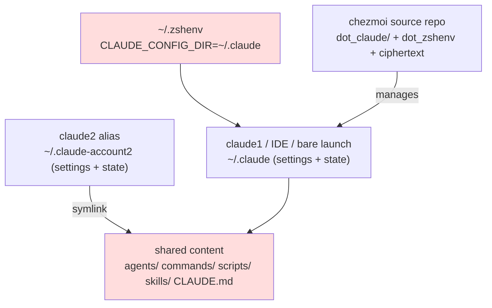

# Unifying two Claude accounts' config and clearing out dead hooks

## Background and constraints

The user asked for a full audit of the two Claude Code configurations, claude1 (`~/.claude`) and claude2 (`~/.claude-account2`), to find what should be improved. The two accounts switch `CLAUDE_CONFIG_DIR` through `.zshrc` aliases.

What the audit found, by severity:

1. **Two hand-written PreToolUse guard hooks had never once fired.** The hooks in settings.json that block `.env` writes and `rm -rf /` both read the `$CLAUDE_TOOL_INPUT` environment variable, but Claude Code does not provide that variable at all — hook input arrives only as **stdin JSON**. Empty variable, no grep match, exit 0, and ==the call passes silently, looking exactly like "nothing wrong here"==.
2. **9 of 13 claudekit hooks had zero execution records.** `~/.claudekit/logs/hook-stats.json` had entries only for file-guard and three Stop hooks; the six PostToolUse `*-changed` hooks and three `*-project` hooks had never run, yet every edit and every stop still spawned their processes for nothing.
3. **Split-brain state files.** `~/.claude.json` (mtime 6-25) and `~/.claude/.claude.json` (still being written that day) coexisted: alias launches used the latter, IDE and bare launches used the former, which is why the tradingview [[MCP]] was visible only inside claude1's alias sessions.
4. **Keys rendered in plaintext into a 644 `.zshrc`.** The approach in [[2026-06-29-chezmoi-plaintext-secrets-to-age-encryption]] decrypts inline in the template with `{{ include "encrypted_secrets.sh.age" | decrypt -}}`. The ciphertext in the source repo is fine, but after apply the plaintext lands in a world-readable `.zshrc`, where any process reading that file, Claude itself included, can see it.
5. **Both accounts held full copies, and they had already drifted.** agents/, commands/, scripts/, skills/, and CLAUDE.md each existed twice, and agents alone had 40+ files out of sync (account1 carried `model: sonnet` frontmatter, account2 had it stripped).
6. **Every session injected descriptions for 42 agents and 73 skills.** More than a dozen of those experts (kafka, mongodb, webpack, and the like) and 12 mutually overlapping frontend "taste" skills have nothing to do with the actual projects, a Python/CV course and trading tooling. Pure context burn.

## Investigation timeline, the key hops

```bash
# hook input format: the log answers it outright
tail ~/.claude/logs/hook-debug.log
# JSON keys: ['session_id', ..., 'tool_input', 'tool_response', ...]  ← stdin JSON
```

A claude-code-guide subagent then checked the official docs to confirm it: `CLAUDE_TOOL_INPUT` is not among the environment variables available to a hook, and input comes only from stdin. That settled the fate of both guard hooks.

```bash
# Dead hooks: don't guess, read the execution stats
cat ~/.claudekit/logs/hook-stats.json   # only 4 hooks have records, 9 never appear

# Split brain: compare mtimes
stat -f "%Sm %N" ~/.claude.json ~/.claude/.claude.json
# Jun 25 ... ~/.claude.json          ← IDE / bare launches still write this one
# Jul  7 ... ~/.claude/.claude.json  ← alias sessions write this one
```

The keys finding was first misread as "the migration never finished". Reading `dot_zshrc.tmpl:200` made it clear this was a designed consequence of the 6-29 approach: inline decrypt renders plaintext into the target file by construction.

## Candidate options for sharing config across the two accounts

### Option A: symlink account2 back to account1

- Approach: replace `~/.claude-account2/{agents,commands,scripts,skills,CLAUDE.md,RTK.md}` with symlinks pointing at `~/.claude/`, and keep each settings.json separate.
- Upside: edit once, both sides see it, zero maintenance, and there is already a working precedent inside the skills directory (a symlink pointing at `~/.agents/skills`).
- Cost: account2 can no longer customize any of these individually, which in practice it never did.

### Option B: put both directory trees under chezmoi templates

- Upside: versioned and portable across machines.
- Cost: every edit needs a `chezmoi apply`, per-account differences need template variables, and the maintenance cost is high; [[2026-06-29-chezmoi-platform-template-breaks-decryption]] already proved template complexity is a real cost.

### Option C: keep the copies, sync them by hand once now

- Upside: the least work.
- Cost: the drift has already happened once and will happen again.

## Decision

==Option A, symlinks.== B lost on maintenance cost, C lost because it has already been disproved. The remaining decisions, all confirmed through AskUserQuestion:

- Subagent model `CLAUDE_CODE_SUBAGENT_MODEL: haiku → sonnet`. The docs confirm ==this environment variable takes priority over an agent's `model:` frontmatter==, so setting it puts every subagent on sonnet, and "keep haiku for a few agents" is not an option.
- The 9 dead claudekit hooks get deleted outright; quality checking moves to running `/validate-and-fix` by hand.
- Agents and skills are archived rather than deleted: agents 36 → 18 (moved to `~/.claude/agents-archive/`), skill entries 24 → 12 (the symlinks go, the source files all live in `~/.agents/skills/`).
- The guard hooks are rewritten: `.env` protection drops down to a declarative deny rule (`Read/Edit/Write(**/.env*)`), and the `rm -rf` guard becomes `~/.claude/scripts/hooks_guard_rm.py`, which reads stdin. Its regexes are identical to the original's, and each was verified one by one against a hand-built stdin JSON payload.
- Split-brain fix: a new `~/.zshenv` sets `export CLAUDE_CONFIG_DIR="$HOME/.claude"` globally, with the aliases overriding it as before; the old `~/.claude.json` is renamed to `.pre-unify.bak`.
- Keys now render into a separate `~/.secrets.sh` (0600, and the filename happens to match Claude Code's default protection pattern), leaving `.zshrc` with a single `source` line. `.zshrc` itself is chmod 600.

## Config resolution after the change



## Wrong turns

- **The permission classifier blocked execution partway through.** Rewriting settings.json and creating `~/.zshenv` were classified as self-modification / persistent changes (the reasoning quoted the user's own words, "I will tell you what to do"), and plan approval did not count. Retrying after collecting item-by-item authorization through AskUserQuestion went straight through. Lesson: for changes to Claude's own config and to shell profiles, settle authorization up front rather than colliding with it mid-execution.
- **The filename `encrypted_secrets.sh.age` matches the default protection pattern**, so the rename and `chezmoi apply ~/.secrets.sh` were two commands I could not touch and had to leave for the user to run by hand. That is the protection mechanism behaving correctly, and it was not worked around.
- **Targets like `~/.claude/settings.json` are themselves under chezmoi's management** (confirmed with `chezmoi managed`), so every edit has to be pushed back with `chezmoi re-add` or the next `chezmoi apply` reverts all of it — a variant of [[merge-old-config-before-templating]]. `.zshrc` is the exception: it is template-rendered, ==must never be re-added==, and can only be changed through `dot_zshrc.tmpl`.

## Not done (YAGNI)

- account3 (`~/.claude-account3`) was left alone; the same duplication problem waits for next time.
- No full `chezmoi apply`: the source templates still hold a batch of unapplied changes unrelated to this work (eza icons, an fzf section reshuffle), and pulling them in would push past the scope of this pass.
- The three keys were not rotated, which is a user-side action; they sat in a 644 file for a while, so reissuing them is still advisable. The 6-29 pass left the same residual risk unclosed.
- No mechanism for auto-loading archived agents per project; if one is needed, move it back.

## Lessons and tricks

- ==An installed hook is not a running hook.== A dead hook that silently exits 0 looks exactly like a normal pass-through, and the only reliable verification is the execution log or stats (`hook-stats.json`, the debug log), or feeding it a hand-built stdin JSON. Same skeleton as [[config-on-disk-is-not-config-in-effect]].
- Claude Code hooks receive input only as stdin JSON; there is no `CLAUDE_TOOL_INPUT` environment variable. Before writing a hook, look at what the debug log actually receives — more reliable than reciting the docs from memory.
- Where a declarative rule (permissions deny) will do, do not write a hook: one less process, and one less way to end up with something installed that never runs.
- For config shared across accounts, independent settings plus symlinked content is the lowest-maintenance split.

## Related

- [[2026-06-29-chezmoi-plaintext-secrets-to-age-encryption]] — this pass revised how it lands (inline decrypt → a separate 0600 file)
- [[2026-06-29-chezmoi-platform-template-breaks-decryption]]
- [[chezmoi]] [[age]] [[MCP]]
- [[config-on-disk-is-not-config-in-effect]]
- [[verify-hooks-fire-before-trusting-them]]
