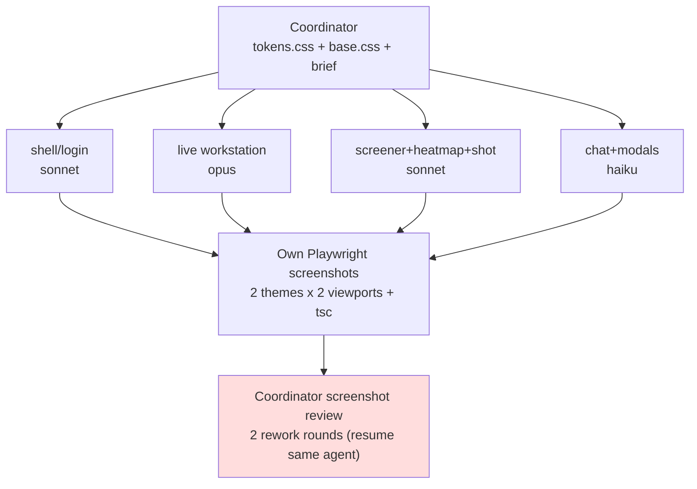

# PriceAction-AB "Quiet Desk" site-wide redesign: four parallel agents and where it broke

A full visual redesign of PriceAction-AB, a trading workstation [[SPA]] built on React and plain CSS custom properties — no Tailwind, one CSS file per pane, `tokens.css` as the single source of tokens. The coordinator (the main session) froze the foundation layer first, then dispatched four parallel subagents that split the panels by file ownership.

## Background and constraints

- Hard constraint: no Tailwind, no CSS-in-JS. The existing architecture stays — one CSS file per pane, `tokens.css` as the single token source. This is a dense trading desk, not a marketing page.
- The actual ask: unify the visuals under a design language called "Quiet Desk". Round two also carries functional changes (NY-timezone axis, portfolio dashboard, watchlist v2, BYO-LLM).
- Order of coordinator actions: rewrite `web/src/styles/tokens.css` (both themes), `web/src/styles/base.css`, and the font loading in `web/index.html`, and treat those as a frozen foundation; then write `docs/design/quiet-desk-brief.md` as the single spec every agent reads; only then dispatch the subagents. That ordering is itself a design decision — without a frozen foundation, four agents each invent their own token usage and the visuals cannot converge.

## Options considered

### Option A: one agent, panels in sequence
- Approach: a single session works through the panels one at a time.
- Upside: no cross-agent conflicts, no file-ownership split to design.
- Cost: there are a lot of panels (shell/login, live workstation, screener/heatmap/shot, chat/modals), and serial execution stretches the timeline badly. The coordinator degenerates into one large agent, which throws away the point of having parallelism at all.

### Option B: four parallel agents, split by mutually exclusive file ownership (chosen)
- Approach: shell/login to one agent (sonnet); live workstation to one agent (opus, heaviest chart logic); screener + heatmap + shot to one agent (sonnet); chat + modals to one agent (haiku, lightest UI work). The four file sets do not overlap.
- Upside: 4x parallelism, and each group has a single responsibility, which makes review easy.
- Cost: file ownership guarantees "who writes which file"; it cannot guarantee "who uses whose class". A shared CSS class — a segmented control, for instance — crosses ownership boundaries with no natural gatekeeper. That cost later turned into a real bug (bug 4 below).

## Decision

Option B, with two mechanisms to hold down the cost of the split:

1. **Every agent self-verifies.** After finishing its own file set, an agent has to take Playwright screenshots in light and dark themes at 1600x950 (desktop) and 390x844 (mobile), run `npx tsc --noEmit`, and review its own output before reporting done.
2. **The coordinator reviews centrally, with rework rounds.** Once all screenshots are in, the coordinator compares them side by side; anything wrong goes back by resuming the same agent as-is, carrying its own context rather than starting a fresh one. Two rounds of rework happened.

## Design language: Quiet Desk

The spec lives in `docs/design/quiet-desk-brief.md`, and all four agents implement against it:

- **Canvas and cards**: white cards (`--panel`/`--border`) on a neutral background (`--bg`), 12px radius (`--radius`), soft ink-tinted shadows — not full-bleed panels welded together by hard 1px borders.
- **Charcoal primary, indigo for interaction**: the primary action button is a charcoal pill (`--primary`); indigo (`--accent`) is reserved for links, focus states, selected states, and the 20-EMA line; purple (`--mentor`) belongs to the AI mentor's voice (chat bubbles, analysis-stream accents) and is never borrowed for anything else.
- **Typographic tiers**: Inter for UI body text, IBM Plex Mono for every number, price, timestamp, and ticker. Instrument Serif is rationed — the login headline and at most one empty-state line per panel — and banned from panel titles and buttons.
- **Frosted glass only on overlays**: `backdrop-filter: blur(16px) saturate(1.4)`, each paired with an `@supports not (backdrop-filter: blur(1px))` fallback (`web/src/styles/chat.css:82-88`, `web/src/styles/live.css:141-146`, `web/src/styles/modals.css:90-94`).

## Ownership split



Standalone version with pan/zoom, light/dark, and PNG/SVG export: [2026-07-10-quiet-desk-redesign-four-parallel-agents.html](2026-07-10-quiet-desk-redesign-four-parallel-agents.html)

## Round-two functional changes

- **NY-timezone axis**: `lightweight-charts` renders ticks in UTC internally, so the data itself is never timezone-converted; only the presentation layer reformats it with `Intl.DateTimeFormat({ timeZone: 'America/New_York' })`. Both `localization.timeFormatter` and `timeScale.tickMarkFormatter` accept a custom formatter (defined at `web/src/components/Chart.tsx:79`, wired in at `:136` and `:138`).
- **Heatmap panel rebuilt as a portfolio dashboard**: new `GET /api/spark` (`server/routes/public.js:69`) proxies Yahoo daily-close data with an in-memory cache of `SPARK_TTL_MS = 10 * 60_000` (`server/routes/public.js:18`) and a cap of 40 symbols per request (the `.slice(0, 40)` at `:70`). The client computes an equal-weight P&L% curve from `entry_record`.
- **Watchlist v2**: ticker icons come from `raw.githubusercontent.com/nvstly/icons`, falling back to an initial-letter monogram when the fetch fails; adding a symbol validates through the quotes endpoint; AI-recommended symbols from `/api/picks` can be added in one click.
- The DS-flash/DS-pro segmented control was removed — there is only the pro tier now, so there is nothing to switch between.
- **BYO-LLM** (bring your own LLM provider): `SettingsModal` writes `localStorage['ab-llm-custom']`, `/api/chat` accepts an `llm` override field, `sanitizeLlmOverride` at `server/llm.js:40` validates and scrubs it, and `server/routes/chat.js:165-166` adds a `POST /api/llm-test` probe endpoint. A deliberately wrong test key was used to grep the server logs and confirm the key never gets logged.

## Bugs and diagnosis

### Bug 1: dark mode not reaching the chart canvas

Symptom: switching to the dark theme changed every part of the UI except the chart — candles, grid, and watermark stayed on the light palette.

Root cause: `ThemeContext` flips the `data-theme` attribute on `document.documentElement` inside its own `useEffect`. React runs child effects before parent effects, so the effect in `Chart.tsx` ran first and read the pre-flip attribute value.

Fix: `readPalette()` idempotently calls `setAttribute('data-theme', theme)` itself before `getComputedStyle`, rather than depending on `ThemeContext`'s effect ordering — `web/src/components/Chart.tsx:41`.

### Bug 2: heatmap tile stretched across the row

Symptom: when a sector contained only one stock, its tile filled the entire row, which at a glance looked like a rendering failure.

Root cause: `.heat-tile { flex: 1 1 120px }` had no `max-width`, so when a row held few tiles, flex-grow handed all the leftover space to one of them.

Fix: add a `max-width` and distribute flex-grow proportionally to percentage change. This fix was later superseded wholesale by round two's fixed-height, ledger-style portfolio dashboard — `web/src/styles/heatmap.css`.

### Bug 3: stray hairlines inside the empty-state chart card

Symptom: with the chart in its no-data empty state, a few thin lines that should not have been there remained visible inside the card.

Root cause: `lightweight-charts` maintains its own canvases with independent stacking, and draws axis tick marks and the watermark at a later DOM position — over the empty-state overlay added afterwards, which had no `z-index`.

Fix: give `.chart-empty` a `z-index: 2` and a background color — `web/src/styles/live.css:101`.

### Bug 4: shared CSS deleted across an ownership boundary (the lesson worth keeping)

Symptom: the heatmap panel's mode switcher rendered as unstyled, welded-together squares.

Diagnosis: while removing the model switcher control, the live-workstation agent deleted `.seg-ctrl`/`.seg-btn` from `live.css` — its own file — as dead code. But `SectorHeatmap.tsx`, a file owned by a different agent, still used both classes. `heatmap.css` only carried overrides for them (`.heat-toolbar .seg-ctrl`, `.heat-toolbar .seg-btn`), so once the base rules were gone the overrides had nothing to attach to and the heatmap switcher became a bare element with no base styling.

Root cause: ==the "dead code" judgement was made by grepping only the files the agent owned, with no repo-wide search==. A file-ownership split guarantees "who writes which file" but never "who uses whose class", and a shared UI recipe crossing an ownership boundary has no natural gatekeeper.

Fix: the coordinator moved the segmented control's base rules into `base.css`, the layer every pane shares, leaving `heatmap.css` with only the overrides at `:62-63` — `web/src/styles/base.css:43-51`.

### Bug 5: doubled prefix from one-click watchlist add

Symptom: adding a symbol from `/api/picks` in one click produced watchlist keys like `NASDAQ:NASDAQ:AAPL`.

Root cause: symbols returned by `/api/picks` are sometimes already in `EXCHANGE:TICKER` form, and the Watchlist side unconditionally prepended `NASDAQ:`.

Fix: prepend only when there is no `:` — `web/src/components/Watchlist.tsx:211` (`sym.includes(':') ? sym : \`NASDAQ:${sym}\``).

### Bug 6: 1px misalignment of the SessionRibbon cursor label

Symptom: on the session progress bar, the label marking the current time sat visibly higher than the phase band it belonged to.

Diagnosis: measured with `getBoundingClientRect()` — the label was at `y=63`, the band at `y=64`, a 1px gap.

Root cause: `.ribbon-cursor-label` was set to `top: -1px`, starting 2px before the band.

Fix: change it to `top: 1px` — `web/src/styles/ribbon.css:115`.

## Not done (YAGNI)

- No automated visual regression tool such as Percy or Chromatic. Acceptance was the coordinator manually comparing Playwright screenshots. At this scale — four agents, two rework rounds — manual comparison stays cheap enough that tooling would not pay for itself.
- No cross-agent inventory of shared classes and no lint rule to enforce one. What came out of this crash is a convention ("shared recipes live in the shared file"), not tooling that enforces it.

## Lessons and tricks

- ==When multiple agents split work by file ownership, a "dead code" call requires a repo-wide grep, not a search restricted to the files you own.== A shared UI recipe — a segmented control or anything else reused across panels — belongs in the shared layer (`base.css`) from the start, rather than sitting in one agent's own file waiting to be mistaken for locally dead code. This has been distilled into [[multi-agent-dead-code-deletion-needs-repo-wide-grep]].
- The foundation layer (tokens, base styles, fonts) has to be frozen by the coordinator before any subagent is dispatched, and written down as one spec document every agent reads (`quiet-desk-brief.md`). Otherwise parallel edits naturally diverge in the details.
- A subagent's self-verification has to cover the dimensions that actually vary. Here that was two themes x two viewports plus type checking; the dimension it did not cover — cross-file class dependencies — is exactly the blind spot bug 4 fell into.
- Canvas rendering libraries like `lightweight-charts` do not understand CSS custom properties, so token values have to be read in JS via `getComputedStyle` and passed in by hand. They also manage several canvases with independent stacking, which produces layering surprises (bugs 1 and 3 are both this shape).

## Verification

`npx tsc --noEmit` fully clean, `vite build` passing, Playwright e2e 7/7. Two of those assertions were rewritten because they tested functionality deliberately removed in this pass (the model segmented control, the old watchlist toggle class) — not regressions. Nine conventional commits:

```
7a5962b docs(design): add quiet desk redesign brief
0ac290d feat(web): quiet desk design tokens, fonts, and shared base styles
af0dec9 feat(llm): custom provider override with settings modal and /api/llm-test
cf9701e feat(web): redesign shell navigation and login brand moment
b75ee42 feat(api): add /api/spark yahoo daily-close proxy for portfolio curve
b9a2511 feat(web): portfolio dashboard with equity curve, redesign screener and shot panes
de44969 feat(web): redesign live workstation, NY time axis, watchlist v2 with icons and AI add
1f8f3dc feat(web): frosted chat widget and overlay modals redesign
1e4c390 test(e2e): cover settings modal and watchlist drawer, drop removed model toggle
```

## Related

- [[multi-agent-dead-code-deletion-needs-repo-wide-grep]]
- [[SPA]]
- [[TTL]]
- [[e2e]]
- [[LLM]]
