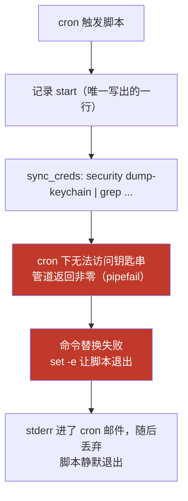

# Cron 看似没触发，实际是脚本静默退出

## 现象

`~/bin/cc-ping.sh` 定时启动 headless Claude 会话做保活，却「好几天没触发」。哪儿都没报错，tmux 也看不到会话，第一反应是 cron 没跑。

## 复现

macOS 上的 crontab 配置如下。

```
0 6,11,16,21 * * * /Users/kelsonqu/bin/cc-ping.sh
```

从 2026-06-20 晚上开始，每到计划时间都能复现：脚本一启动就退出，没留下报错。

## 排查过程

1. 先怀疑 cron 本身：

   ```bash
   crontab -l
   tail -60 ~/.cache/cc-ping.log
   ```

   关键输出：crontab 记录还在，日志每天 6、11、16、21 点都有 `===== start session=... =====`。==cron 一直在触发==，「根本没触发」是错觉。真正的异常在后面：6-20 以前每轮都有完整的 start → ready → done，6-20 的 `21:00` 以后每轮都**只剩 start 行**。

2. 缩小退出范围。start 之后，最先必定记日志的位置在 `sync_creds` 里：成功、失败、没找到这三个分支都会调用 `log`。再往下的 `dump_screen "after-launch"` 也必定追加日志。两处都没出现，说明脚本在 `sync_creds` 里就退出了。旧脚本没把 stderr 写盘，cron 又丢掉了邮件，所以一点动静都没有。

3. 读 `sync_creds`，找到会让脚本退出的组合。脚本开头是 `set -euo pipefail`，函数里有：

   ```bash
   result="$(security dump-keychain 2>/dev/null \
     | grep -oE '"Claude Code-credentials[^"]*"' \
     | ... | sort -t$'\t' -k1,1nr | head -n1)"
   ```

   cron 下没有 GUI 安全会话，`security dump-keychain` 访问不了钥匙串就会失败。即使能访问，`grep` 找不到匹配也会返回 1。开了 `pipefail`，这两种情况都会让整个管道返回非零，命令替换的赋值随之失败，`set -e` 让脚本退出。这些都发生在 `tmux new-session` 之前，根本没启动会话。

4. 验证下文的修复。先检查语法，再用 cron 同样的最小环境完整跑一遍：

   ```bash
   bash -n ~/bin/cc-ping.sh
   env -i HOME="$HOME" PATH="<PATH from crontab>" SHELL=/bin/bash ~/bin/cc-ping.sh
   ```

   日志显示链路跑全了，退出码是 0：

   ```
   [2026-07-07T13:33:12] ===== start session=cc-ping-1783456392 =====
   [2026-07-07T13:33:12] synced freshest keychain credential (exp=...) -> ~/.claude/.credentials.json
   [2026-07-07T13:33:27] claude is ready, sending message
   [2026-07-07T13:33:45] ===== done =====
   ```

5. 单独验钥匙串完全不可用的情况：最小复现里用 `false` 替换 `security`，确认在 `set -euo pipefail` 下，脚本现在会走 WARN 分支，继续跑到正常退出。

   > 这轮测试碰巧能访问钥匙串。`env -i` 清的是环境变量，GUI 安全会话还在。第 4 步走了成功分支，失败分支靠第 5 步的最小复现来验证。



## 根因

==在 `set -euo pipefail` 下，cron 环境里的 `sync_creds` 钥匙串管道必定返回非零：`security` 没有 GUI 会话会失败，或者 `grep` 找不到匹配。命令替换赋值失败，触发 `set -e`，脚本还没启动 tmux 就退出。stderr 一直没写盘，表面上就像「cron 没触发」。==

## 修复

`~/bin/cc-ping.sh` 改了 3 处。

- `cc-ping.sh:11` 加 `exec 2>>"$LOG"`，把所有 stderr 写进日志，下次失败就有记录。
- `cc-ping.sh:51` 在钥匙串管道末尾加 `|| true`，凭据缺失就走 WARN 分支，脚本照跑。
- `cc-ping.sh:74` 的调用改成 `sync_creds || log "WARN: ..."`。用 `||` 调用函数时，函数体内的 `set -e` 不生效，内部错误不会再让脚本退出，Claude 会回退到现有凭据文件。

其余部分，比如 tmux 和 send-keys，仍然需要遇到错误就退出，所以保留 `set -euo pipefail`。只有尽力同步凭据这一段需要容错，例外就留在这里。

## 经验

- 「定时任务没触发」先分清是**调度没发生**还是**脚本静默退出**。日志里有没有 start 标记，一眼就能区分。日志放哪儿见 [[zh/Techniques/log-placement|log-placement]]。
- `set -e`、命令替换和 `pipefail` 会让脚本静默退出。`var="$(a | b)"` 中任意一环返回非零都会让脚本退出，连 `grep` 没匹配而返回 1 这种正常情况也一样。见 [[zh/Techniques/command-substitution-failure-kills-script-under-set-e|command-substitution-failure-kills-script-under-set-e]]。
- 在 cron 脚本第一行业务逻辑之前放 `exec 2>>"$LOG"`，否则错误都会进 cron 邮件然后丢掉。
- 用 `env -i HOME=... PATH=<PATH from crontab>` 模拟 cron 脚本的环境。不过 macOS 钥匙串按安全会话决定能否访问，和环境变量无关。`env -i` 模拟不了「钥匙串不可用」，这个分支得单独做最小复现。

## 相关

- [[zh/Glossary/pipefail|pipefail]]
- [[zh/Techniques/log-placement|log-placement]]
- [[zh/Techniques/systematic-troubleshooting|systematic-troubleshooting]]
- [[zh/Techniques/command-substitution-failure-kills-script-under-set-e|command-substitution-failure-kills-script-under-set-e]]
