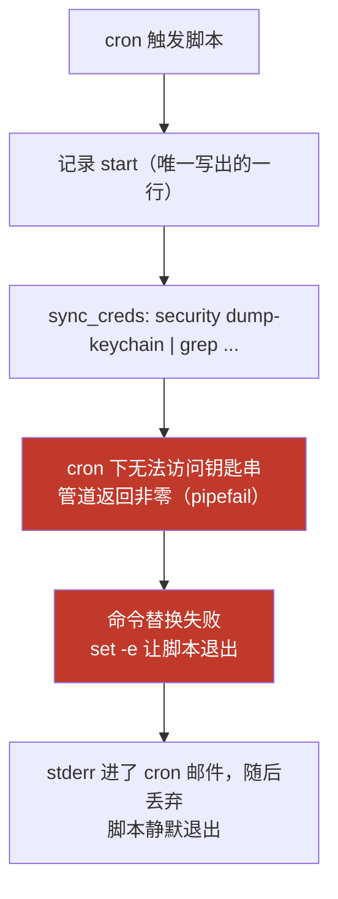

# Cron 看似没触发，实际是脚本静默退出

## 现象

`~/bin/cc-ping.sh` 定时拉起 headless Claude 会话保活，却「好几天没触发」。哪里都没报错，tmux 里也看不到会话，第一反应是 cron 没跑。

## 复现

macOS 上的 crontab 配置如下：

```
0 6,11,16,21 * * * /Users/kelsonqu/bin/cc-ping.sh
```

从 2026-06-20 晚上起，每到点就能复现：脚本刚启动就退出，没留报错。

## 排查过程

1. 先怀疑 cron 本身：

   ```bash
   crontab -l
   tail -60 ~/.cache/cc-ping.log
   ```

   看输出：crontab 记录还在，日志每天 6、11、16、21 点都有 `===== start session=... =====`。==cron 一直在触发==，「没触发」是错觉。真正的异常在后面：6-20 之前每轮都有完整的 start → ready → done，6-20 `21:00` 之后每轮都**只剩 start 行**，后面的全没了。

2. 缩小退出区间。start 之后，最先必定打日志的地方在 `sync_creds` 里（成功、失败、没找到三个分支都会调 `log`），再往下 `dump_screen "after-launch"` 也会无条件追加日志。两处都没出现，说明脚本在 `sync_creds` 里就退出了。旧脚本没把 stderr 落盘，cron 又把邮件丢了，所以一点声响都没有。

3. 读 `sync_creds`，找到致命组合。脚本开头开了 `set -euo pipefail`，函数里有这一段：

   ```bash
   result="$(security dump-keychain 2>/dev/null \
     | grep -oE '"Claude Code-credentials[^"]*"' \
     | ... | sort -t$'\t' -k1,1nr | head -n1)"
   ```

   cron 下没有 GUI 安全会话，`security dump-keychain` 访问不了钥匙串会失败；就算能访问，`grep` 找不到匹配也会返回 1。开了 `pipefail`，这两种情况都会让整条管道返回非零，命令替换赋值跟着失败，`set -e` 直接退出脚本。全发生在 `tmux new-session` 之前，会话根本没起。

4. 验证下面的修复。先查语法，再用跟 cron 一样的最小环境跑一遍：

   ```bash
   bash -n ~/bin/cc-ping.sh
   env -i HOME="$HOME" PATH="<PATH from crontab>" SHELL=/bin/bash ~/bin/cc-ping.sh
   ```

   日志显示全链路跑完，退出码 0：

   ```
   [2026-07-07T13:33:12] ===== start session=cc-ping-1783456392 =====
   [2026-07-07T13:33:12] synced freshest keychain credential (exp=...) -> ~/.claude/.credentials.json
   [2026-07-07T13:33:27] claude is ready, sending message
   [2026-07-07T13:33:45] ===== done =====
   ```

5. 单独测钥匙串完全不可用的分支：写最小复现把 `security` 换成 `false`，确认在 `set -euo pipefail` 下脚本现在会走 WARN 分支，照常跑完退出。

   > 这轮测试碰巧能访问钥匙串。`env -i` 清的是环境变量，GUI 安全会话还在。第 4 步测的是成功分支，失败分支靠第 5 步的最小复现覆盖。



## 根因

==在 `set -euo pipefail` 下，cron 环境里 `sync_creds` 的钥匙串管道必定返回非零（没 GUI 会话时 `security` 失败，或者 `grep` 没匹配）。命令替换赋值失败触发 `set -e`，脚本还没启动 tmux 就退出。stderr 一直没写盘，表面上就像「cron 没触发」。==

## 修复

`~/bin/cc-ping.sh` 改了 3 处：

- `cc-ping.sh:11` 加 `exec 2>>"$LOG"`，所有 stderr 写进日志，以后失败就有记录。
- `cc-ping.sh:51` 在钥匙串管道末尾加 `|| true`，凭据缺失就走 WARN 分支，不让脚本崩掉。
- `cc-ping.sh:74` 改成 `sync_creds || log "WARN: ..."`。用 `||` 调函数时，函数体内的 `set -e` 不生效，内部出错不会再退出脚本，Claude 回退用现有凭据文件。

不直接去掉 `set -euo pipefail`，是因为后面的 tmux 和 send-keys 仍然要遇错即停。只有尽力同步凭据这一段需要容错，例外就收在这一处。

## 经验

- 「定时任务没触发」先分清是**调度没发生**还是**脚本静默退出**，看日志里有没有 start 标记一眼就能区分。日志打在哪里见 [[zh/Techniques/log-placement|log-placement]]。
- `set -e`、命令替换加 `pipefail` 是典型的静默退出组合：`var="$(a | b)"` 里只要有一环返回非零，脚本就会退出，哪怕是 `grep` 没匹配而返回 1 这种正常情况。见 [[zh/Techniques/command-substitution-failure-kills-script-under-set-e|command-substitution-failure-kills-script-under-set-e]]。
- cron 脚本第一行业务逻辑前先加 `exec 2>>"$LOG"`，不然报错全进了 cron 邮件然后丢掉。
- 用 `env -i HOME=... PATH=<PATH from crontab>` 可以模拟 cron 环境，但 macOS 钥匙串权限跟安全会话走，不跟环境变量走。`env -i` 模拟不了「钥匙串不可用」，那条分支得单独做最小复现。

## 相关

- [[zh/Glossary/pipefail|pipefail]]
- [[zh/Techniques/log-placement|log-placement]]
- [[zh/Techniques/systematic-troubleshooting|systematic-troubleshooting]]
- [[zh/Techniques/command-substitution-failure-kills-script-under-set-e|command-substitution-failure-kills-script-under-set-e]]
