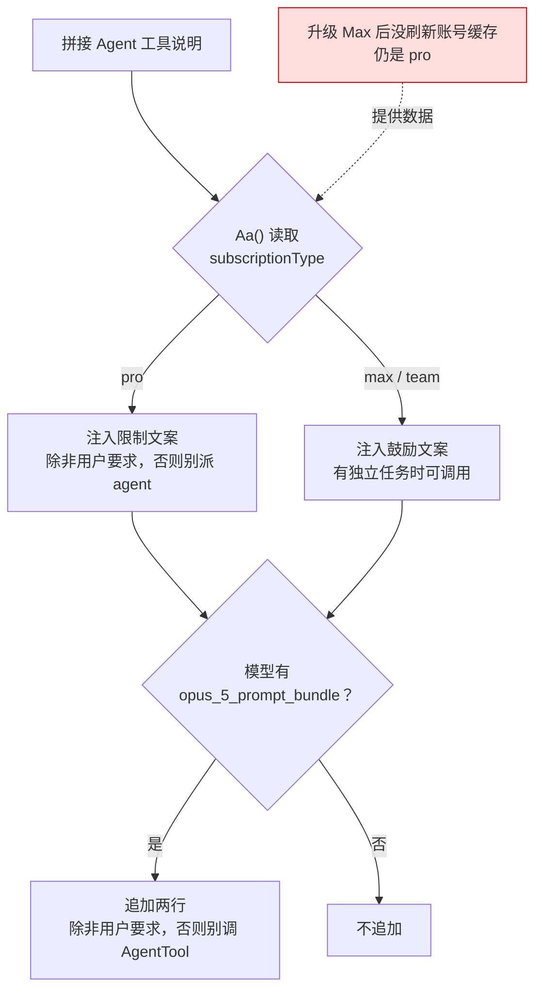

# 本地配置都对，订阅缓存过期却让 subagent 从不主动启动

## 现象

起因是想确认「我的模型默认会不会派 subagent」，实际观察它从不主动派。翻遍 `~/.claude/` 都找不到原因，上下文里却躺着这么一段：

```
**Do not spawn agents unless the user asks.** Each spawn starts cold and
re-derives context you already have — it's the expensive path on this plan.
```

唯一的线索是 `this plan`。这段话跟着订阅档位走，也不是用户写的。

## 复现

每个会话都有，不用特殊操作，一启动就在。

## 排查过程

1. **先怀疑自己的配置。** 查设置：

   ```bash
   grep -nE 'model|SUBAGENT|effort' ~/.claude/settings.json
   ```

   输出 `50: "model": "opus"` 和 `220: "effortLevel": "xhigh"`。没有 `CLAUDE_CODE_SUBAGENT_MODEL`、`Agent(...)` 权限规则或 hook。顺带发现一处不一致：记忆里把主模型记成 fable，实际是 opus，那是另一回事。

2. **全局搜原文**，确认不是自己配置带进来的：

   ```bash
   grep -rn "Do not call the AgentTool" ~/.claude/
   ```

   0 条结果，只可能来自 CLI 本身。

3. **找二进制文件**：

   ```bash
   which -a claude          # → /Users/kelsonqu/.local/bin/claude
   ls -la ~/.local/bin/claude  # → symlink to versions/2.1.220
   file 2.1.220             # → Mach-O 64-bit executable arm64
   ```

   是编译好的原生二进制，没有独立的 `cli.js`，但 JS 源码还以字符串形式留在里面：

   ```bash
   strings -n 20 2.1.220 | grep -i "Do not call the AgentTool"
   ```

   搜到了，来源确定。

4. **第一个弯路：直接从二进制抓上下文。** 想看这段话受什么条件控制：

   ```bash
   grep -a -o -E ".{280}\*\*Do not spawn agents unless the user asks" 2.1.220
   ```

   报 `grep: maximum repetition exceeds 255`。BRE/ERE 的 `{n}` 上限是 255。

5. **第二个弯路：降到 250 也不行。** `.{250}` 不报错了，但跑满 120 秒后切进了后台。拿回溯型正则扫几十 MB 的二进制，慢到没法用。

6. **换办法：先导出再 grep。** 之后每次查询几秒就出结果：

   ```bash
   strings -n 6 2.1.220 > "$TMPDIR/cc.strings"   # 394254 lines
   grep -n -B4 "Do not spawn agents unless" "$TMPDIR/cc.strings"
   ```

   查到拼接逻辑：

   ```js
   f=Cq()==="default",
   m=Aa()==="pro"?`
   **Do not spawn agents unless the user asks.** ...`:""
   ```

   `m` 是拼进 Agent 工具说明的槽位。**条件就是订阅档位等于 `pro`。**

7. **继续查 `Aa()`**：

   ```js
   function Aa(){if(f3i())return p3i();if(!zb())return null;
                 let e=ms();if(!e)return null;return e.subscriptionType??null}
   function f3i(){return fXt&&Ibc!==null&&!1}
   ```

   `f3i()` 末尾的 `&&!1` 让它恒为假，是死分支。所以 `Aa()` 实际只从缓存的账号记录读 `subscriptionType`。

8. **还有另一层与订阅无关的限制。** 文件末尾的「Do not call the AgentTool」和「Do not use workflows」走另一套逻辑：

   ```js
   ttp=["Do not call the AgentTool unless the user requested it",
        "Do not use workflows or deep-research unless the user requested it"]
   function tXn(e){if(e===void 0)return!1;
                   if(LN(lo(e),"opus_5_prompt_bundle")!==!0)return!1;
                   return!Ke(nug,!1)}
   nug="tengu_fennel_godwit"
   ```

   它只看模型有没有 `opus_5_prompt_bundle`，任何订阅档位都会注入。遥测代号是 `heron_brook`。同个 bundle 里还有 `# Delivering work` 和 `# Corrections`，跟官方 Opus 5 提示词指南的建议几乎一字不差，说明是官方调校，不是针对个人降级。

9. **试着直接读账号档位，被拦住了**：

   ```bash
   grep -o '"subscriptionType":"[^"]*"' ~/.claude/.claude.json   # empty
   grep -o '"subscriptionType":"[^"]*"' ~/.claude/.credentials.json
   # → Access denied: '.credentials.json' is protected by default patterns
   ```

   hook 拦下了凭据文件，拦得对。这条路走不通，只能推断。

10. **确认 `pro` 分支独占这段话**，排除其他档位也注入同样文案：

    ```bash
    grep -c "Do not spawn agents unless the user asks" "$TMPDIR/cc.strings"   # → 1
    grep -o -E 'Aa\(\)==="(max|team|enterprise)"\?' "$TMPDIR/cc.strings"      # → empty
    ```

    整个二进制只出现 1 次，没有 max/team 分支用它。上下文里有这段话，就能断定 `Aa()` 此刻返回的是 `"pro"`。

11. **可用户说账号是每月 $200 的 Max。** 两边只能对一个。剩两种可能：当前用的不是那个 Max 账号（用户用 claude1/2/3 分多账号，account2 软链到 `~/.claude`），或者升级后缓存的 `subscriptionType` 一直没刷新。哪种都需要重新登录。

12. **重新登录后复查。** 二进制没变（`grep -c` 仍是 1，文案还在第 351940 行），但上下文的 `m` 槽空了，换成了另一条分支（第 351949 行）：

    > Reach for this when the task matches an available agent type, **when you have independent work to run in parallel** ...

    从「别派」变成「合适就派」。第二层限制的两行还在，符合预期。

## 根因

两层独立条件叠在一起，出问题的是左边这条链路：



==本地配置全都没错，但 Claude Code 缓存的 OAuth 账号记录里，`subscriptionType` 还停在升级前的 `pro`。== 二进制按这个旧值注入了 Pro 专用的限制文案，表现出来就是「从不主动派 subagent」，翻遍配置也找不到解释。

## 修复

重新登录，代码和配置都不用改。

`~/.claude/settings.json:50` 的 `"model": "opus"` 保持不动。官方文档说 Opus 5 在长程 agent 任务上有明显提升，成本只有 Fable 5 的一半，「拿 Fable 做调度」的前提已经不成立。

## 经验

- **`this plan`、`your plan`、`on this tier` 这类措辞是很强的线索。** 这说明文案是按账号状态动态拼的，值得直接查身份缓存，不用再翻更多配置。
- **配置正确不等于运行时状态正确。** 这是 [[zh/Techniques/config-on-disk-is-not-config-in-effect|config-on-disk-is-not-config-in-effect]] 更隐蔽的情况。那篇是文件写了没加载，这次文件和加载都对，错在运行时缓存的**身份**。先看 `/status` 确认运行时认的是哪个账号和档位，再去翻代码。
- 从二进制查字符串的方法单独记在 [[zh/Techniques/dump-then-grep-strings-from-binaries|dump-then-grep-strings-from-binaries]]。
- 凭据读不到照样能推断：确认生成某段文案的分支全局唯一、没有平级分支也会生成它，只要看到这段文案，就能证明该条件成立，不用读到实际值。

## 相关

- [[zh/Techniques/config-on-disk-is-not-config-in-effect|config-on-disk-is-not-config-in-effect]]
- [[zh/Techniques/dump-then-grep-strings-from-binaries|dump-then-grep-strings-from-binaries]]
- [[zh/Cases/Design/2026-07-25-trimming-claude-md-and-splitting-agents-index|2026-07-25-trimming-claude-md-and-splitting-agents-index]]
- [[zh/Cases/Design/2026-07-07-unifying-dual-account-claude-config|2026-07-07-unifying-dual-account-claude-config]]
- [[zh/Glossary/MCP|MCP]]
