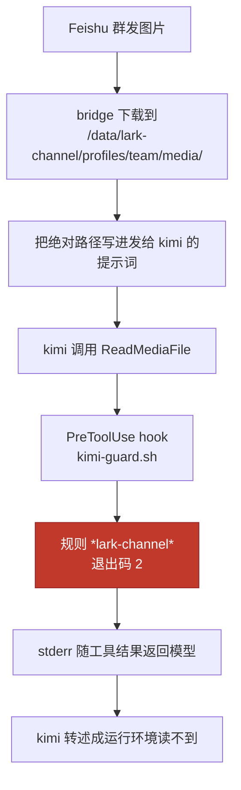

# Feishu 群里发图，kimi 说读不了，根因是我写的 guard 规则拦得太宽

## 现象

往 Feishu 群里发截图，机器人回：

> Sorry, I can't view this image — the media directory where the bridge stores attachments is unreadable from my runtime, so the image content never reaches me. Please send it another way: if the image is text, paste or type the text directly.

这段回复很误导人。听着像沙箱或容器挂载有问题，其实原因在别处。

## 复现

给 `lark-team-bot`（跑在 docker 里的 lark-channel-bridge 加 kimi）发任何图片，次次复现。纯文字正常，`.md` 附件一样读不了。

## 排查过程

1. **先找附件实际存哪。** `lark-channel-bridge` 的 README 有状态目录表：

   ```bash
   grep -n -A8 "附件" /opt/homebrew/lib/node_modules/lark-channel-bridge/README.zh.md
   ```

   `README.zh.md:232` 写着附件缓存在 `~/.lark-channel/profiles/<profile>/media/`。

2. **怀疑文件权限。** 快速查一下：

   ```bash
   ls -la ~/.lark-channel/profiles/claude/media/
   ```

   目录 755、文件 644，都可读。排除 POSIX 权限。

3. **第一个弯路：以为是 Claude Code 的路径边界。** media 目录在工作区 cwd 外，`~/.claude/settings.json` 的 `additionalDirectories` 只列了 `/tmp` 和 `~/Desktop`。已有 issue 符合这个症状（`anthropics/claude-code#29013`：`additionalDirectories` 不给 Read 工具授权，报 EPERM）。

   但用 Read 读本地 media 目录里的 jpg，图片正常显示。再翻 bridge 的会话记录：

   ```bash
   grep -l "profiles/claude/media" ~/.claude/projects/-Users-kelsonqu--lark-channel-workspaces-claude-default/*.jsonl
   ```

   4 个会话里，每次 `Read` 读图都返回正常的 `tool_result`，格式是 `{"type":"image","source":{"type":"base64",...}}`。==这条路径一直通着，Claude Code 这边没出问题。==

4. **第二个弯路：以为是扩展名问题。** media 目录混着几个 `.bin`，看着像 bridge 认不出 MIME 类型就回退成 `.bin`，读图工具认不出来。

   ```bash
   cd ~/.lark-channel/profiles/claude/media && for f in *.bin; do file -b "$f"; done
   ```

   3 个全是 `Zip archive data`，其实是 pptx，图片本来就是 `.jpg`。排除。

5. **回到最初的提示：「去看 kimi 的 docker」。** 前面查的都是本地 Claude bridge，报错来自另一套：

   ```bash
   docker ps -a --format '{{.Names}}\t{{.Status}}'
   ```

   输出 `lark-team-bot  Up 26 hours`。容器里跑着同样的 bridge，只是 agent 换成了 kimi，靠 `kimi-as-claude.mjs` 把 kimi 伪装成 `claude` 二进制让 bridge 照常调。`Dockerfile` 配的是 `LARK_CHANNEL_HOME=/data/lark-channel` 和 `WORKDIR=/data/workspace`。

6. **读 guard。** `kimi-guard.sh` 是 kimi 的 `config.toml` 注册的 PreToolUse hook。看 `kimi-guard.sh:72` 附近：

   ```sh
   case "$P" in
     *lark-channel*)
       block "blocked: /data/lark-channel is the bridge's encrypted keystore, ..." ;;
   ```

   一条子串规则封了整棵目录树，附件缓存 `profiles/<p>/media/` 正好就在里面。

7. **拿到决定性证据。** guard 的 `block()` 会打日志：

   ```bash
   docker exec lark-team-bot sh -c 'grep media /data/kimi-guard.log | tail -3'
   ```

   ```
   2026-08-11T08:33:05Z  blocked: ... off limits
     tool_name:"Bash"  command:"ls -la /data/lark-channel/profiles/team/media/c5698cbe….jpg"
   2026-08-11T08:33:17Z  blocked: ... off limits
     tool_name:"ReadMediaFile"  path:"/data/lark-channel/profiles/team/media/c5698cbe….jpg"
   2026-08-13T19:15:53Z  blocked: ... off limits
     tool_name:"Bash"  command:"file /data/lark-channel/profiles/team/media/54b2e413….jpg"
   ```

   最后一条时间戳对得上我刚发的图。kimi 先用 Bash 的 `file` 探测类型，被拦后就放弃了。08-11 的两条记录更完整：guard 拦下 `ls` 后，不到 12 秒它就改调正确的 `ReadMediaFile`，guard 还是拦掉了。

## 根因

==bridge 把聊天附件下进了加密密钥库所在的目录树，guard 用 `*lark-channel*` 一条子串规则封了整棵树，附件跟着打不开。==

时间线也吻合。`kimi-guard.sh` 的注释记着，2026-08-10 之前 hook 的 matcher 只有 `Bash`，Read / Write / Edit 不走 guard，图片一直能看。matcher 扩到 `Bash|Edit|Write|Read` 那天，原本写给 *Bash 命令字符串* 的规则开始套在*单个文件路径*上，影响范围变了，没人重新审一遍。

还有个细节：`ReadMediaFile` 没命中 guard 里精确匹配的 `Read|Edit|Write)` 分支，一路落到匹配整份事件 JSON 的兜底规则上被拦下。matcher 是没加锚点的正则（`new RegExp("Bash|Edit|Write|Read").test(name)`），放进了 `ReadMediaFile`，脚本里却没分支接它。



## 修复

改了 3 个文件，对应 commit `fff71f0` 和 `bbbfd21`。

**从 `kimi-guard.sh:68` 开始**，把 `ReadMediaFile` 加进文件工具分支（核对过 kimi 二进制里的 zod schema，输入字段也叫 `path`），只给只读工具开明确的例外：

```sh
case "$TOOL:$P" in
  Read:*/lark-channel/profiles/*/media/*|ReadMediaFile:*/lark-channel/profiles/*/media/*)
    case "$P" in *..*) ;; *) exit 0 ;; esac ;;
esac
```

例外只放行 media 这一层，路径带 `..` 照样拦，`Write` / `Edit` 也照旧拦截。Bash 仍不能碰整棵树：它能跑任意 shell 命令，靠字符串分析管不住，guard 注释也这么写。不过拦截提示现在会指明改用 `ReadMediaFile`；kimi 习惯先用 `file` 或 `ls` 试探，看到「off limits」就放弃，不提示它不会换工具。

**`AGENTS.md:285`** 原来写整棵 `/data/lark-channel` 禁读，补上 media 例外。文档不同步，kimi 读完可能连试都不试。

**`entrypoint.sh`** 顺带查了要不要做 GC。结论是附件不用，kimi 会话目录需要。

| 目录 | 增长量 | 上限 |
|-|-|-|
| `profiles/*/media/` | 6 天 1.2 MB | 有，`enforceCacheMaxBytes` 限制为 512 MB |
| `.kimi-code/sessions/` | 5 天 13 MB | 无 |

bridge 每收到附件都会执行 `cacheMaxBytes`，容量兜住了。配置里的 `cacheTtlMs: 24h` 只在解析时读过一次，后面没地方用，根本没做按时间清理。我没补这项：磁盘没压力，真加上反而会让「昨天那张图」读不到，不划算。

会话目录是一个会话一个、从不回收，把清理放到启动时：

```sh
find "$S" -mindepth 2 -maxdepth 2 -type d -name 'session_*' -mtime +30 -prune -exec rm -rf {} +
```

30 天跟 shim 的 `.kac-tier` 标记有效期一致，过期后本来就 resume 不了，删的全是已经恢复不了的旧会话。镜像里没装 cron，就放在启动时跑。

跑完 `docker compose build && up -d`，在容器里直接给 guard 传测试事件验证：`ReadMediaFile` 读真实附件退出码 0，`Read` 读密钥库配置退出码 2，`Bash file` 查同一张图也是退出码 2。

## 经验

- ==agent 说「我没有权限读 X」时，那只是它转述的说法，不是原始报错。== 直接翻 hook 或 guard 日志里的拦截记录，`tool_name` 和完整的 `tool_input` 都在里面，比猜 agent 的措辞快得多。见 [[zh/Techniques/check-hook-logs-when-an-agent-claims-no-permission|check-hook-logs-when-an-agent-claims-no-permission]]。
- 用路径子串写拒绝规则，等于默认整棵目录树都是敏感内容。缓存目录和凭据共用 `HOME` 很常见，写规则前先 `ls` 看一眼目录结构。
- 扩大 hook matcher 覆盖的工具范围，现有规则的语义也会跟着变。匹配 *shell 命令字符串* 的规则套到*单个文件路径*上，影响面完全不同。
- 没加锚点的 matcher 正则会吸进意料之外的工具名（比如 `Read` 匹配 `ReadMediaFile`）。脚本里如果按精确名字分派，就会出现工具进来了却没分支接的空档。

## 相关

- [[zh/Agents/widening-a-hook-matcher-revisits-every-rule|widening-a-hook-matcher-revisits-every-rule]]
- [[zh/Agents/verify-hooks-fire-before-trusting-them|verify-hooks-fire-before-trusting-them]]
- [[zh/Techniques/check-hook-logs-when-an-agent-claims-no-permission|check-hook-logs-when-an-agent-claims-no-permission]]
- [[zh/Glossary/TTL|TTL]]
- [[zh/Glossary/GC|GC]]
- [[zh/Cases/Design/2026-07-07-unifying-dual-account-claude-config|2026-07-07-unifying-dual-account-claude-config]]
