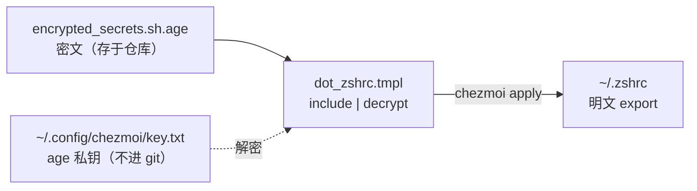

# chezmoi 仓库里的明文 API key 迁到 age 加密

## 背景与约束

本来想用 `chezmoi status` 检查本地改动，再同步回 dotfiles 源仓库。结果有 5 个文件在本地更新了，源仓库的 git 工作树却是干净的。`chezmoi diff` 显示本地 `.zshrc` 多了 `APIROUTER_API_KEY` 那一行，顺带查出源仓库的 `dot_zshrc` 一直用明文存 `DEEPSEEK_API_KEY` 和 `ODYSSEUS_API_TOKEN`。

用 `gh repo view` 确认 `github.com:KaichenQu/dotfiles.git` 是私有仓库，没有正在发生的公开泄露，但 git 历史里的明文 key 始终是隐患。

约束如下。

- 只有 1 台 macOS 机器，不想为这件事装一堆工具。
- key 要随 dotfiles 一起走，换机器还能恢复。
- `.zshrc` 大部分是普通配置，只有 3 行是 key。整份文件变成看不懂的密文，diff 也没法看，不能接受。

## 候选方案

3 个方向都可行。

### 方案 A：macOS 钥匙串加 chezmoi 模板

- 做法：用 `security add-generic-password` 把 key 存到登录钥匙串，再用 chezmoi 内置的 `keyring` 函数在 `dot_zshrc.tmpl` 里取出来。
- 好处：系统原生支持，不用另外装工具。
- 代价：key 不跟仓库走，换机器得重新填钥匙串，key 本身也没备份介质。

### 方案 B：age 加密

- 做法：`brew install age`，生成 age 密钥对，在 chezmoi 配置 `encryption = "age"`，以密文把 key 放进仓库，age 私钥留在机器上。
- 好处：密文跟仓库同步，换机器只需 age 私钥就能解密，chezmoi 原生支持。
- 代价：多装个工具，还要保管 age 私钥。

### 方案 C：拆到 `~/.zshrc.local`，让 chezmoi 忽略

- 做法：key 移到本地文件，从 `.zshrc` 用 source 加载，再用 `.chezmoiignore` 排除它。
- 好处：工作量最小，key 不会进 git。
- 代价：chezmoi 不再管理 key，换机器要手动重建，本地仍是明文。

## 决定

==选方案 B，用 age 加密。== 决定因素是「key 要跟仓库走，换机器能恢复」。A 和 C 都把 key 留在同一台机器上，无法同步也没有备份。B 把密文放进仓库，只需另存 age 私钥，正好符合要求。多装 `age` 可以接受。

对历史里已经出现过的 key，选择了重写历史（`git filter-repo`），没有重新签发。代价见下文「未做事项」。

## 实现

目标只加密文件中的几行，其余照常保留。所以没有用 `chezmoi add --encrypt`，它会把整个 `.zshrc` 变成密文。把 3 行 `export` 抽成独立的加密片段，模板渲染时解密并拼回去。

```bash
# 1. Tooling and keys
brew install age git-filter-repo
age-keygen -o ~/.config/chezmoi/key.txt    # private key, chmod 600, outside the source dir
# chezmoi.toml: encryption="age" + [age] identity/recipient(public key)

# 2. Encrypt the three keys into a single fragment
chezmoi encrypt secrets.sh > ~/.local/share/chezmoi/encrypted_secrets.sh.age

# 3. Templatize dot_zshrc: drop the three plaintext lines, append the decrypt
git mv dot_zshrc dot_zshrc.tmpl
# {{ include "encrypted_secrets.sh.age" | decrypt -}}

# 4. Check the render, then apply
chezmoi cat ~/.zshrc   # confirm the three keys decrypt correctly
chezmoi apply ~/.zshrc
```

渲染时的数据流：



## 弯路：缺失的 pathspec 让整次 git add 失效

执行 `git mv dot_zshrc dot_zshrc.tmpl` 后，习惯性地把新旧文件名放进同一次 add：

```
git add dot_zshrc dot_zshrc.tmpl encrypted_secrets.sh.age
# fatal: pathspec 'dot_zshrc' did not match any files
```

`dot_zshrc` 已经改名，旧路径不存在。==这处匹配不到的 pathspec 让整条 `git add` 报 fatal，另外两个文件也没暂存。== 没人留意那行 fatal，接着就提交了，提交里只有 `git mv` 留在 index 里的内容，明文还在，加密文件完全没进去。直到用 `git show HEAD:dot_zshrc.tmpl | grep` 才发现明文还在。

修法是单独跑 `git add dot_zshrc.tmpl encrypted_secrets.sh.age`，然后 `git commit --amend`。最后用 `git show HEAD:` 确认模板没有明文，用 `git ls-tree HEAD` 确认提交里有加密文件。

还有个小坑：`git filter-repo` 跑完会移除 `origin` remote，防止误推回原仓库。先存 URL，跑完用 `git remote add` 加回来，再 force push。

清理历史并验证：

```bash
git filter-repo --replace-text replacements.txt --force   # three plaintext values ==> ***REMOVED***
git log --all -S '<key string>' --oneline | wc -l         # all three should be 0
git push --force origin main
```

重写了全部 17 个 commit。逐个检查 3 个明文字符串，结果都是 0 个 commit。force push 也完成了。

## 未做事项（YAGNI）

- 没有重新签发 key。重写历史和 force push 只覆盖分支，==旧 commit 仍可能在一段时间内通过旧 SHA 从 GitHub 访问==，这些值确实曾以明文存在。要彻底消除这个隐患，只能轮换 key。这次明确接受了这个剩余风险。
- `.claude/plugins/*.json` 这类日常变化没进 commit，只改了 key 相关文件。
- 没接钥匙串或 1Password CLI。单机加 age 足够，等真有多机或团队场景再看。

## 经验

- 用 chezmoi 加密文件的*一部分*时，把秘密单独抽成加密片段（`chezmoi encrypt` → `encrypted_*.age`），再在模板里用 `{{ include "..." | decrypt }}` 拼回去。对整份文件用 `--encrypt` 会让整份文件的 diff 都看不懂。
- age 私钥 `key.txt` 是唯一能解密的东西，必须单独备份，不能进 git。放在 `~/.config/chezmoi/` 而不放源目录，chezmoi 就不会管理它。
- 改完先用 `chezmoi cat` 检查渲染结果，确认后再用 `chezmoi apply` 写盘。见 [[zh/Techniques/reproduce-before-fixing-verify-after|reproduce-before-fixing-verify-after]]。
- 多个 pathspec 里只要有一个匹配不到，整次 `git add` 就报 fatal，什么也不暂存。提交前先看 `git status`，或者 add 时别带已经改掉的旧名。详见 [[zh/Agents/git-add-multi-pathspec-fails-atomically|git-add-multi-pathspec-fails-atomically]]。

## 相关

- [[zh/Glossary/chezmoi|chezmoi]] [[zh/Glossary/age|age]]
- [[zh/Techniques/config-on-disk-is-not-config-in-effect|config-on-disk-is-not-config-in-effect]]
- [[zh/Cheatsheets/git|git]]：历史重写、force push
- [[zh/Agents/git-add-multi-pathspec-fails-atomically|git-add-multi-pathspec-fails-atomically]]
