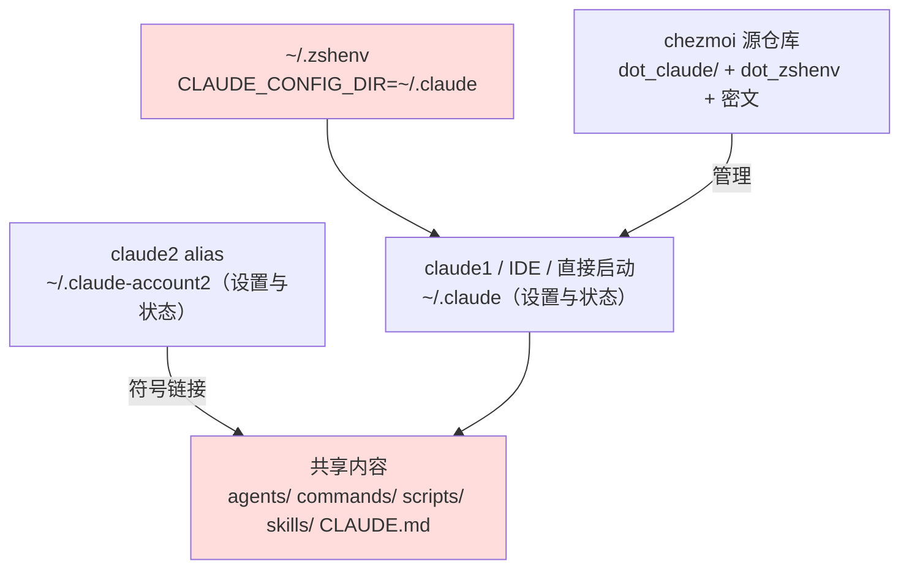

# 两个 Claude 账号的配置归并与失效 hook 清理

## 背景与约束

用户想把 Claude Code 两套配置从头审一遍，找出该改的地方。claude1 用 `~/.claude`，claude2 用 `~/.claude-account2`，靠 `.zshrc` 的 alias 切换 `CLAUDE_CONFIG_DIR`。

按严重程度排，查出的问题如下：

1. **两条手写的 PreToolUse guard hook 一次都没生效。** settings.json 里拦 `.env` 写入和 `rm -rf /` 的 hook 都去读环境变量 `$CLAUDE_TOOL_INPUT`，但 Claude Code 根本没提供这个变量，hook 输入只走 **stdin JSON**。变量为空，grep 匹配不上，退出码 0，==调用悄悄放行，看着一切正常==。
2. **13 条 claudekit hook 里有 9 条执行记录为 0。** `~/.claudekit/logs/hook-stats.json` 里只有 file-guard 和 3 条 Stop hook 的记录。6 条 PostToolUse `*-changed` 和 3 条 `*-project` 从没跑出过有效逻辑，每次 edit 和 stop 却照常拉起进程空转。
3. **状态文件分裂。** `~/.claude.json`（mtime 6-25）和 `~/.claude/.claude.json`（当天还在写）同时存在。alias 启动写后者，IDE 和直接启动写前者，导致 tradingview [[zh/Glossary/MCP|MCP]] 只在 claude1 的 alias 会话里看得到。
4. **key 明文渲染进了权限 644 的 `.zshrc`。** [[zh/Cases/Design/2026-06-29-chezmoi-plaintext-secrets-to-age-encryption|2026-06-29-chezmoi-plaintext-secrets-to-age-encryption]] 是在模板里用 `{{ include "encrypted_secrets.sh.age" | decrypt -}}` 内联解密。源仓库里是密文，apply 后明文就写进了人人可读的 `.zshrc`，任何读 `.zshrc` 的进程都能看到，包括 Claude 自己。
5. **两个账号各留了一套完整副本，已经分岔。** agents/、commands/、scripts/、skills/ 和 CLAUDE.md 全有两份。光 agents 就有 40 多个文件不一致：account1 留着 `model: sonnet` frontmatter，account2 去掉了。
6. **每个会话都注入 42 个 agent 和 73 个 skill 的说明。** 十几个无关领域专家（kafka、mongodb、webpack 等）和 12 个互相重叠的前端「审美」skill，跟实际的 Python/CV 课程和交易工具毫不相干，白白占着上下文。

## 排查要点

```bash
# hook input format: the log answers it outright
tail ~/.claude/logs/hook-debug.log
# JSON keys: ['session_id', ..., 'tool_input', 'tool_response', ...]  ← stdin JSON
```

接着让 claude-code-guide subagent 查官方文档确认：hook 可用环境变量里没有 `CLAUDE_TOOL_INPUT`，输入只走 stdin。两条 guard hook 怎么改也就定了。

```bash
# Dead hooks: don't guess, read the execution stats
cat ~/.claudekit/logs/hook-stats.json   # only 4 hooks have records, 9 never appear

# Split brain: compare mtimes
stat -f "%Sm %N" ~/.claude.json ~/.claude/.claude.json
# Jun 25 ... ~/.claude.json          ← IDE / bare launches still write this one
# Jul  7 ... ~/.claude/.claude.json  ← alias sessions write this one
```

明文 key 起初误判成「迁移没做完」。看了 `dot_zshrc.tmpl:200` 才明白，这是 6-29 方案的固有结果：模板内联解密，本来就会往目标文件写出明文。

## 共享配置的候选方案

### 方案 A：account2 用符号链接指向 account1

- 做法：把 `~/.claude-account2/{agents,commands,scripts,skills,CLAUDE.md,RTK.md}` 换成指向 `~/.claude/` 的符号链接，各自保留自己的 settings.json。
- 好处：改一处两边立刻生效，不用维护。skills 目录早有先例，里面的符号链接指向 `~/.agents/skills`。
- 代价：account2 不能再单独定制这些内容，平时它也从没单独定制过。

### 方案 B：两棵目录树都上 chezmoi 模板

- 好处：有版本管理，能跨机迁移。
- 代价：每次改都要 `chezmoi apply`，账号差异得写模板变量，维护重。[[zh/Cases/Debug/2026-06-29-chezmoi-platform-template-breaks-decryption|2026-06-29-chezmoi-platform-template-breaks-decryption]] 已经证明模板复杂度会带来真实代价。

### 方案 C：保留两份副本，现在手动同步一次

- 好处：改动最小。
- 代价：已经分岔过一次，以后照样会分岔。

## 决定

==选方案 A，用符号链接。== B 维护成本太高，现实已经否定了 C。其余决定都通过 AskUserQuestion 确认过：

- subagent 模型 `CLAUDE_CODE_SUBAGENT_MODEL: haiku → sonnet`。文档证实了 ==这个环境变量优先级高于 agent 的 `model:` frontmatter==，设了以后所有 subagent 全走 sonnet，没法给少数几个留 haiku。
- 9 条失效的 claudekit hook 直接删掉，质量检查改手工跑 `/validate-and-fix`。
- agent 和 skill 只归档不删源文件。agent 从 36 → 18，挪进 `~/.claude/agents-archive/`；skill 入口从 24 → 12，删的是符号链接，源文件都在 `~/.agents/skills/`。
- 重写 guard hook：`.env` 保护改成声明式 deny 规则（`Read/Edit/Write(**/.env*)`），`rm -rf` 改写成读 stdin 的 `~/.claude/scripts/hooks_guard_rm.py`，正则不变，每条都拿手写 stdin JSON 逐一验过。
- 解决状态文件分裂：建 `~/.zshenv` 全局设 `export CLAUDE_CONFIG_DIR="$HOME/.claude"`，alias 照常覆盖；旧 `~/.claude.json` 改名为 `.pre-unify.bak`。
- key 改渲染到独立的 `~/.secrets.sh`，权限 0600，文件名刚好命中 Claude Code 默认保护模式。`.zshrc` 只留一行 `source`，权限也改 chmod 600。

## 改完后的配置读取路径



## 弯路

- **权限分类器半路拦住了执行。** 改 settings.json 和建 `~/.zshenv` 归进了自我修改和持久化变更（理由引了用户原话「I will tell you what to do」），批准计划不算批准这两步。在 AskUserQuestion 里逐项拿到授权后再试，一次通过。改 Claude 自身配置或 shell 启动文件，提前拿清楚授权，别做到一半卡住。
- **`encrypted_secrets.sh.age` 命中了默认保护模式。** 改名和 `chezmoi apply ~/.secrets.sh` 都过不了保护，只能留给用户自己执行。保护机制按预期工作，没有绕开。
- **`~/.claude/settings.json` 这类文件归 chezmoi 管理**（用 `chezmoi managed` 查过）。改完要跑 `chezmoi re-add` 回写，不然下次 `chezmoi apply` 会冲掉改动，这是 [[zh/Techniques/merge-old-config-before-templating|merge-old-config-before-templating]] 的变体。`.zshrc` 是例外，由模板渲染，==绝不能 re-add==，只能改 `dot_zshrc.tmpl`。

## 未做事项（YAGNI）

- account3（`~/.claude-account3`）没动，同样的副本问题留到下次。
- 没跑全量 `chezmoi apply`。源模板里还有批无关的未应用改动（eza 图标、fzf 段落重排），把它们一起 apply 进去会越界。
- 3 把 key 没轮换，需要用户自己处理。它们在权限 644 的文件里放过一段时间，还是建议重新签发，和 6-29 那次一样留着这个剩余风险。
- 没做按项目自动加载归档 agent 的机制，要用哪个再挪回来。

## 经验

- ==装上 hook 不等于 hook 真在跑。== 失效的 hook 静默退出 0，跟正常放行一模一样。靠谱的验法是看执行日志或统计（`hook-stats.json`、debug 日志），或者手写 stdin JSON 传给它跑一遍。排查思路跟 [[zh/Techniques/config-on-disk-is-not-config-in-effect|config-on-disk-is-not-config-in-effect]] 相同。
- Claude Code 的 hook 只从 stdin JSON 拿输入，没有 `CLAUDE_TOOL_INPUT` 环境变量。写 hook 前先看 debug 日志实际收到什么，比凭印象背文档稳妥。
- 声明式规则（permissions deny）够用就别写 hook，少起一个进程，也少一个「装了却没跑」的隐患。
- 多账号共用配置，独立 settings 加符号链接共享内容，维护成本最低。

## 相关

- [[zh/Cases/Design/2026-06-29-chezmoi-plaintext-secrets-to-age-encryption|2026-06-29-chezmoi-plaintext-secrets-to-age-encryption]]：这次改了落地方式，从内联解密换成独立 0600 文件
- [[zh/Cases/Debug/2026-06-29-chezmoi-platform-template-breaks-decryption|2026-06-29-chezmoi-platform-template-breaks-decryption]]
- [[zh/Glossary/chezmoi|chezmoi]] [[zh/Glossary/age|age]] [[zh/Glossary/MCP|MCP]]
- [[zh/Techniques/config-on-disk-is-not-config-in-effect|config-on-disk-is-not-config-in-effect]]
- [[zh/Agents/verify-hooks-fire-before-trusting-them|verify-hooks-fire-before-trusting-them]]
