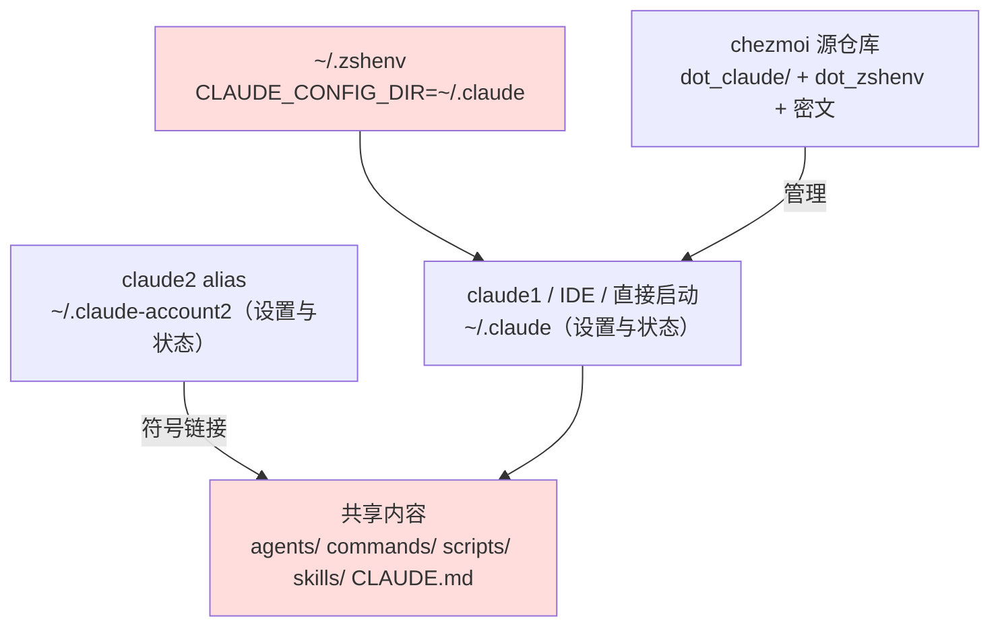

# 两个 Claude 账号的配置归并与失效 hook 清理

## 背景与约束

用户要把 Claude Code 的两套配置从头查一遍，找出该改的地方。claude1 用 `~/.claude`，claude2 用 `~/.claude-account2`，靠 `.zshrc` 的 alias 切换 `CLAUDE_CONFIG_DIR`。

按严重程度排列，审计发现如下。

1. **两条手写的 PreToolUse guard hook 一次都没起作用。** settings.json 里拦 `.env` 写入和 `rm -rf /` 的 hook 都读环境变量 `$CLAUDE_TOOL_INPUT`，但 Claude Code 根本不提供它，hook 输入只从 **stdin JSON** 来。变量为空，grep 匹配不到，退出码 0，==调用就悄悄通过了，看起来一切正常==。
2. **13 条 claudekit hook 里有 9 条执行记录为 0。** `~/.claudekit/logs/hook-stats.json` 里只有 file-guard 和 3 条 Stop hook 的记录。6 条 PostToolUse `*-changed` 和 3 条 `*-project` 从未实际执行到有效逻辑，每次 edit 和 stop 却照样白启动这些进程。
3. **状态文件分裂。** `~/.claude.json`（mtime 为 6-25）和 `~/.claude/.claude.json`（当天仍在写入）同时存在。alias 启动用后者，IDE 和直接启动用前者，所以 tradingview [[zh/Glossary/MCP|MCP]] 只在 claude1 的 alias 会话里可见。
4. **key 以明文渲染到权限为 644 的 `.zshrc`。** [[zh/Cases/Design/2026-06-29-chezmoi-plaintext-secrets-to-age-encryption|2026-06-29-chezmoi-plaintext-secrets-to-age-encryption]] 的做法是在模板内用 `{{ include "encrypted_secrets.sh.age" | decrypt -}}` 解密。源仓库里的密文没问题，但 apply 会把明文把明文写进任何人都能读的 `.zshrc`。任何读取 `.zshrc` 的进程都能看到明文，Claude 自己也一样。
5. **两个账号各有整套副本，内容已经分岔。** agents/、commands/、scripts/、skills/ 和 CLAUDE.md 都有两份。光 agents 就有 40 多个文件不一致，account1 保留了 `model: sonnet` frontmatter，account2 去掉了。
6. **每个会话都注入 42 个 agent 和 73 个 skill 的说明。** 十几个专家（kafka、mongodb、webpack 等）和 12 个互相重叠的前端「审美」skill，跟实际的 Python/CV 课程和交易工具项目没关系，白占上下文。

## 排查过程中的关键步骤

```bash
# hook input format: the log answers it outright
tail ~/.claude/logs/hook-debug.log
# JSON keys: ['session_id', ..., 'tool_input', 'tool_response', ...]  ← stdin JSON
```

接着让 claude-code-guide subagent 查官方文档确认：hook 可用的环境变量里没有 `CLAUDE_TOOL_INPUT`，输入只走 stdin。两条 guard hook 怎么处理就有了依据。

```bash
# Dead hooks: don't guess, read the execution stats
cat ~/.claudekit/logs/hook-stats.json   # only 4 hooks have records, 9 never appear

# Split brain: compare mtimes
stat -f "%Sm %N" ~/.claude.json ~/.claude/.claude.json
# Jun 25 ... ~/.claude.json          ← IDE / bare launches still write this one
# Jul  7 ... ~/.claude/.claude.json  ← alias sessions write this one
```

起初把明文 key 误判成「迁移没做完」。读过 `dot_zshrc.tmpl:200` 才明白，这是 6-29 方案的预期结果：模板内联解密，本来就会在目标文件里渲染明文。

## 共享配置的候选方案

### 方案 A：account2 用符号链接指向 account1

- 做法：把 `~/.claude-account2/{agents,commands,scripts,skills,CLAUDE.md,RTK.md}` 换成指向 `~/.claude/` 的符号链接，各自保留 settings.json。
- 好处：改一处，两边都能看见，无需维护。skills 目录已有可用的先例，里面的符号链接指向 `~/.agents/skills`。
- 代价：account2 不能再单独定制这些内容，实际上它也从没单独定制过。

### 方案 B：两棵目录树都用 chezmoi 模板

- 好处：可做版本管理，也能跨机器迁移。
- 代价：每次改动都要 `chezmoi apply`，账号差异要写成模板变量，维护成本高。[[zh/Cases/Debug/2026-06-29-chezmoi-platform-template-breaks-decryption|2026-06-29-chezmoi-platform-template-breaks-decryption]] 已经证明模板复杂度会带来实际成本。

### 方案 C：保留两份副本，现在手动同步一次

- 好处：工作量最小。
- 代价：已经分岔过一次，以后还会再分岔。

## 决定

==选方案 A，用符号链接。== B 的维护成本高，C 已经让实际结果推翻了。其余决定都通过 AskUserQuestion 确认过。

- subagent 模型 `CLAUDE_CODE_SUBAGENT_MODEL: haiku → sonnet`。文档确认 ==这个环境变量的优先级高于 agent 的 `model:` frontmatter==，设了就会让所有 subagent 都用 sonnet，不能再给某几个保留 haiku。
- 9 条失效的 claudekit hook 直接删，质量检查改为手动跑 `/validate-and-fix`。
- agent 和 skill 只归档，不删源文件。agent 从 36 → 18，移到 `~/.claude/agents-archive/`。skill 入口从 24 → 12，移除的是符号链接，源文件都在 `~/.agents/skills/`。
- 重写 guard hook：`.env` 保护改用声明式 deny 规则（`Read/Edit/Write(**/.env*)`），`rm -rf` 的 guard 改为读取 stdin 的 `~/.claude/scripts/hooks_guard_rm.py`。正则与原来完全相同，每条都用手写的 stdin JSON 输入逐个验证。
- 解决状态文件分裂：新增 `~/.zshenv`，全局设 `export CLAUDE_CONFIG_DIR="$HOME/.claude"`，alias 仍能覆盖。旧 `~/.claude.json` 改名为 `.pre-unify.bak`。
- key 现在渲染到独立的 `~/.secrets.sh`，权限设为 0600，文件名也碰巧符合 Claude Code 默认保护模式。`.zshrc` 只留一行 `source`，本身也执行 chmod 600。

## 改完后的配置读取路径



## 弯路

- **权限分类器中途拦住了执行。** 重写 settings.json 和创建 `~/.zshenv` 归为自我修改或持久化变更（判定理由引用了用户的原话「I will tell you what to do」），批准计划不等于批准这两项。通过 AskUserQuestion 逐项取得授权后重试，直接通过。改 Claude 自己的配置或 shell 启动文件，应事先明确授权，避免做到一半才碰壁。
- **`encrypted_secrets.sh.age` 文件名符合默认保护模式。** 改名和 `chezmoi apply ~/.secrets.sh` 都过不了保护，只能留给用户手动执行。这是保护机制按预期工作，没有绕过。
- **`~/.claude/settings.json` 这类目标本身就归 chezmoi 管理**，用 `chezmoi managed` 核实过。编辑后要用 `chezmoi re-add` 回写，不然下次 `chezmoi apply` 会覆盖改动。这是 [[zh/Techniques/merge-old-config-before-templating|merge-old-config-before-templating]] 的变体。`.zshrc` 是例外，它由模板渲染，==绝不能 re-add==，只能改 `dot_zshrc.tmpl`。

## 未做事项（YAGNI）

- account3（`~/.claude-account3`）没动，同样的副本问题留到下次。
- 没跑完整的 `chezmoi apply`。源模板还有一批与这次无关、尚未应用的改动（eza 图标和 fzf 段落重排），顺手应用会超出范围。
- 3 把 key 没有轮换，需要用户自己操作。它们曾在权限为 644 的文件里放了一段时间，仍建议重新签发。6-29 那次也留下了同样的未消除风险。
- 没加按项目自动加载归档 agent 的机制，需要哪个就移回来。

## 经验

- ==装上 hook 不等于 hook 真在跑。== 失效的 hook 静默退出 0，跟正常放行看起来一样。可靠的验证是看执行日志或统计（`hook-stats.json`、debug 日志），或手写 stdin JSON 直接喂给它。排查思路与 [[zh/Techniques/config-on-disk-is-not-config-in-effect|config-on-disk-is-not-config-in-effect]] 一样。
- Claude Code 的 hook 只从 stdin JSON 接收输入，没有 `CLAUDE_TOOL_INPUT` 环境变量。写 hook 先看 debug 日志实际收到什么，比凭记忆背文档可靠。
- 声明式规则（permissions deny）够用就别写 hook。少个进程，也少个「装了但从不运行」的坑。
- 多账号共用配置时，独立 settings 配上符号链接共享内容，维护成本最低。

## 相关

- [[zh/Cases/Design/2026-06-29-chezmoi-plaintext-secrets-to-age-encryption|2026-06-29-chezmoi-plaintext-secrets-to-age-encryption]]：这次改了落地方式，从内联解密改为独立的 0600 文件
- [[zh/Cases/Debug/2026-06-29-chezmoi-platform-template-breaks-decryption|2026-06-29-chezmoi-platform-template-breaks-decryption]]
- [[zh/Glossary/chezmoi|chezmoi]] [[zh/Glossary/age|age]] [[zh/Glossary/MCP|MCP]]
- [[zh/Techniques/config-on-disk-is-not-config-in-effect|config-on-disk-is-not-config-in-effect]]
- [[zh/Agents/verify-hooks-fire-before-trusting-them|verify-hooks-fire-before-trusting-them]]
