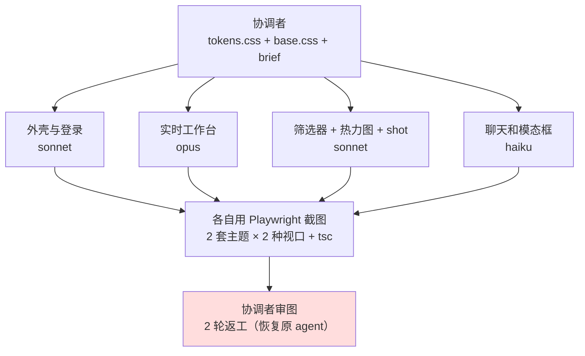

# PriceAction-AB 的 Quiet Desk 改版：4 个并行 agent 与实际踩坑

PriceAction-AB 是交易工作台 [[zh/Glossary/SPA|SPA]]，这次重做全站视觉。技术栈是 React 和原生 CSS 自定义属性，不用 Tailwind，每个面板有自己的 CSS 文件，token 全从 `tokens.css` 来。协调者（主会话）先冻结基础层，再派出 4 个 subagent，按文件归属拆分面板并行改。

## 背景与约束

- 硬约束是不用 Tailwind 和 CSS-in-JS。架构沿用每个面板一份 CSS、`tokens.css` 提供全部 token 的做法。页面是高密度交易台，按交易台的用途来排版。
- 实际要求是用 Quiet Desk 这套设计语言统一视觉。第二轮还改了功能，包括 NY 时区坐标轴、持仓看板、watchlist v2 和 BYO-LLM。
- 协调者先重写 `web/src/styles/tokens.css`（两套主题）、`web/src/styles/base.css` 和 `web/index.html` 的字体加载，冻结为基础层。然后写 `docs/design/quiet-desk-brief.md`，让所有 agent 只认这一份规格，最后才派 subagent。顺序本身就是设计决定：不先冻结基础层，4 个 agent 会各自发明 token 用法，最后视觉凑不到一起。

## 候选方案

### 方案 A：单个 agent 依次改面板

- 做法：同一会话按顺序处理各面板。
- 好处：不会有 agent 间冲突，也无需设计文件归属。
- 代价：面板很多（shell/login、live workstation、screener/heatmap/shot、chat/modals），串行会拖长工期。协调者变成包办全部工作的大 agent，并行就失去了意义。

### 方案 B：4 个 agent 并行，各自负责互不重叠的文件（采用）

- 做法：shell/login 给 sonnet，live workstation 给 opus（图表逻辑最重），screener + heatmap + shot 给 sonnet，chat + modals 给 haiku（界面工作最轻）。四组文件互不重叠。
- 好处：并行度是 4 倍，每组职责单一，容易审查。
- 代价：文件归属能约定「谁写哪个文件」，约定不了「谁用了谁的 class」。分段控件这类共享 CSS class 跨过归属边界后，没人天然负责兜底。这个代价后来变成了实际 bug（下文第 4 项）。

## 决定

选方案 B，用两项措施控制拆分的代价。

1. **每个 agent 自验。** 做完自己负责的文件后，用 Playwright 给浅色和深色主题分别截 1600x950（桌面）和 390x844（手机）的图，跑 `npx tsc --noEmit`，先看过自己的结果再报完成。
2. **协调者集中审查，可以打回。** 截图齐了就并排比对。有问题时恢复原来的 agent，让它带着原上下文返工，省去重开会话。实际返工了 2 轮。

## Quiet Desk 设计语言

规格在 `docs/design/quiet-desk-brief.md`，4 个 agent 都按它实现。

- **底色和卡片**：中性底色（`--bg`）上放白色卡片（`--panel` / `--border`），圆角为 12px（`--radius`），阴影用柔和的墨色。面板之间留空，不用硬邦邦的 1px 边框把满幅面板焊在一起。
- **主按钮用炭灰，交互用靛蓝**：主操作是炭灰色胶囊按钮（`--primary`）。靛蓝（`--accent`）只用于链接、焦点态、选中态和 20-EMA 线。紫色（`--mentor`）只给 AI mentor 的声音用，包括聊天气泡和分析流的强调色。
- **字体层级**：UI 正文用 Inter，数字、价格、时间戳和 ticker 一律用 IBM Plex Mono。Instrument Serif 只给登录大标题，以及每个面板最多一行空状态文案，面板标题和按钮不用它。
- **磨砂玻璃只用于浮层**：用 `backdrop-filter: blur(16px) saturate(1.4)`，每处都配 `@supports not (backdrop-filter: blur(1px))` 回退（`web/src/styles/chat.css:82-88`、`web/src/styles/live.css:141-146`、`web/src/styles/modals.css:90-94`）。

## 文件归属



支持平移和缩放、浅色和深色主题以及 PNG/SVG 导出的独立版本：[2026-07-10-quiet-desk-redesign-four-parallel-agents.html](../../../Cases/Design/2026-07-10-quiet-desk-redesign-four-parallel-agents.html)

## 第二轮功能改动

- **NY 时区轴**：`lightweight-charts` 内部用 UTC 渲染刻度，数据本身不转时区，只在显示时用 `Intl.DateTimeFormat({ timeZone: 'America/New_York' })` 格式化。`localization.timeFormatter` 和 `timeScale.tickMarkFormatter` 都接受自定义 formatter，定义在 `web/src/components/Chart.tsx:79`，接在 `:136` 和 `:138`。
- **热力图面板改成持仓看板**：新增 `GET /api/spark`（`server/routes/public.js:69`）代理 Yahoo 日收盘价。内存缓存用 `SPARK_TTL_MS = 10 * 60_000`（`server/routes/public.js:18`），每次最多查 40 个 symbol（`:70` 的 `.slice(0, 40)`）。客户端从 `entry_record` 算等权 P&L% 曲线。
- **Watchlist v2**：ticker 图标从 `raw.githubusercontent.com/nvstly/icons` 取，取不到就显示首字母图标。新增 symbol 时经由 quotes 端点校验，也能一键添加 `/api/picks` 里由 AI 推荐的标的。
- 移除 DS-flash/DS-pro 分段控件。现在只剩 pro 档位，已经没得切换。
- **BYO-LLM**（自带 LLM provider）：`SettingsModal` 写入 `localStorage['ab-llm-custom']`，`/api/chat` 接受 `llm` 覆盖字段，`server/llm.js:40` 的 `sanitizeLlmOverride` 校验并清理它，`server/routes/chat.js:165-166` 新增 `POST /api/llm-test` 探针端点。故意用错误的测试 key，再 grep 服务端日志，确认没有把 key 写进日志。

## Bug 与诊断

### Bug 1：图表 canvas 没跟着切深色

现象：切深色主题后，界面其他部分都变了，图表的 K 线、网格和水印却还用浅色配色。

根因：`ThemeContext` 在自己的 `useEffect` 里切换 `document.documentElement` 的 `data-theme` 属性。React 先跑子组件的 effect，`Chart.tsx` 的 effect 读到的还是切换前的属性值。

修复：在 `web/src/components/Chart.tsx:41`，`readPalette()` 先自己幂等地执行 `setAttribute('data-theme', theme)`，再调用 `getComputedStyle`，摆脱对 `ThemeContext` effect 顺序的依赖。

### Bug 2：热力图色块撑满整行

现象：板块只有 1 只股票时，色块铺满整行，乍看像渲染坏了。

根因：`.heat-tile { flex: 1 1 120px }` 没配 `max-width`，一行色块很少时，flex-grow 把余下空间都给了其中一块。

修复：加 `max-width`，再按涨跌幅比例分配 flex-grow。第二轮固定高度、账簿式布局的持仓看板后来整个替换了它，见 `web/src/styles/heatmap.css`。

### Bug 3：图表空状态卡片内残留细线

现象：图表无数据时，空状态卡片里还露出几根本该看不见的细线。

根因：`lightweight-charts` 维护自己的 canvas，各有堆叠顺序。轴刻度和水印画在靠后的 DOM 位置，盖过后来加的空状态浮层，浮层也没有 `z-index`。

修复：给 `.chart-empty` 加 `z-index: 2` 和背景色，见 `web/src/styles/live.css:101`。

### Bug 4：跨文件归属边界误删共享 CSS（值得记下的教训）

现象：热力图面板的模式切换器变成挤在一起、没样式的方块。

诊断：live workstation 的 agent 移除模型切换控件时，把自己负责的 `live.css` 里的 `.seg-ctrl` / `.seg-btn` 当成死代码删了。可另一位 agent 负责的 `SectorHeatmap.tsx` 还在用这两个 class。`heatmap.css` 只有覆写（`.heat-toolbar .seg-ctrl`、`.heat-toolbar .seg-btn`），基础规则一删，覆写就没了可叠加的基础，切换器因此失去样式。

根因：==判断「死代码」时只 grep 了 agent 自己负责的文件，没有搜全仓库==。文件归属只能保证「谁写哪个文件」；「谁用哪个 class」还得另外检查，共享 UI 样式一跨归属就没有天然的把关人。

修复：协调者把分段控件的基础规则移到所有面板共用的 `base.css`（`web/src/styles/base.css:43-51`），`heatmap.css` 在 `:62-63` 只留覆写。

### Bug 5：一键加 watchlist 时前缀重复

现象：从 `/api/picks` 一键添加 symbol，watchlist key 变成 `NASDAQ:NASDAQ:AAPL` 这种形式。

根因：`/api/picks` 返回的 symbol 有时已经是 `EXCHANGE:TICKER` 格式，Watchlist 却一律再加 `NASDAQ:`。

修复：只有不含 `:` 时才加前缀，见 `web/src/components/Watchlist.tsx:211`（`` sym.includes(':') ? sym : `NASDAQ:${sym}` ``）。

### Bug 6：SessionRibbon 游标标签错位 1px

现象：交易时段进度条上的当前时间标签，比所属的阶段色带明显偏高。

诊断：用 `getBoundingClientRect()` 量，标签在 `y=63`，色带在 `y=64`，差 1px。

根因：`.ribbon-cursor-label` 设了 `top: -1px`，比色带提前 2px 开始。

修复：改成 `top: 1px`，见 `web/src/styles/ribbon.css:115`。

## 未做事项（YAGNI）

- 没上 Percy、Chromatic 等自动视觉回归工具。验收靠协调者手动对比 Playwright 截图；这次只有 4 个 agent、2 轮返工，手工成本够低，引入工具不划算。
- 没建跨 agent 的共享 class 清单，也没加 lint 规则。故障后定下的是约定：「共用样式放到共享文件里」，暂时没有配套工具强制执行。

## 经验

- ==多个 agent 按文件归属拆活时，判断死代码得 grep 全仓库，只搜自己负责的文件不够。== 分段控件这类跨面板复用的 UI 样式，从一开始就应放到共享层（`base.css`）。留在某个 agent 的文件里，就容易让它误判为没人在用。已提炼到 [[zh/Agents/multi-agent-dead-code-deletion-needs-repo-wide-grep|multi-agent-dead-code-deletion-needs-repo-wide-grep]]。
- 协调者要在派 subagent 之前冻结基础层（token、基础样式、字体），写进所有 agent 都会读的同一份规格（`quiet-desk-brief.md`）。否则并行修改自然会在细节上走岔。
- subagent 自验要覆盖实际会变化的维度。这次是 2 套主题 × 2 种视口，再加类型检查。没覆盖的维度是跨文件 class 依赖，正好成了 Bug 4 的盲区。
- `lightweight-charts` 等 canvas 渲染库不认识 CSS 自定义属性，得在 JS 里用 `getComputedStyle` 读取 token 后手动传入。库还管理各自堆叠的多层 canvas，容易出现图层次序问题，Bug 1 和 3 都属此类。

## 验证

`npx tsc --noEmit` 无报错，`vite build` 通过，Playwright e2e 通过 7/7。两项断言因为这次明确移除了对应功能而重写（模型分段控件、旧 watchlist 切换 class），属于预期改动。共有 9 个符合 Conventional Commits 的提交：

```
7a5962b docs(design): add quiet desk redesign brief
0ac290d feat(web): quiet desk design tokens, fonts, and shared base styles
af0dec9 feat(llm): custom provider override with settings modal and /api/llm-test
cf9701e feat(web): redesign shell navigation and login brand moment
b75ee42 feat(api): add /api/spark yahoo daily-close proxy for portfolio curve
b9a2511 feat(web): portfolio dashboard with equity curve, redesign screener and shot panes
de44969 feat(web): redesign live workstation, NY time axis, watchlist v2 with icons and AI add
1f8f3dc feat(web): frosted chat widget and overlay modals redesign
1e4c390 test(e2e): cover settings modal and watchlist drawer, drop removed model toggle
```

## 相关

- [[zh/Agents/multi-agent-dead-code-deletion-needs-repo-wide-grep|multi-agent-dead-code-deletion-needs-repo-wide-grep]]
- [[zh/Glossary/SPA|SPA]]
- [[zh/Glossary/TTL|TTL]]
- [[zh/Glossary/e2e|e2e]]
- [[zh/Glossary/LLM|LLM]]
