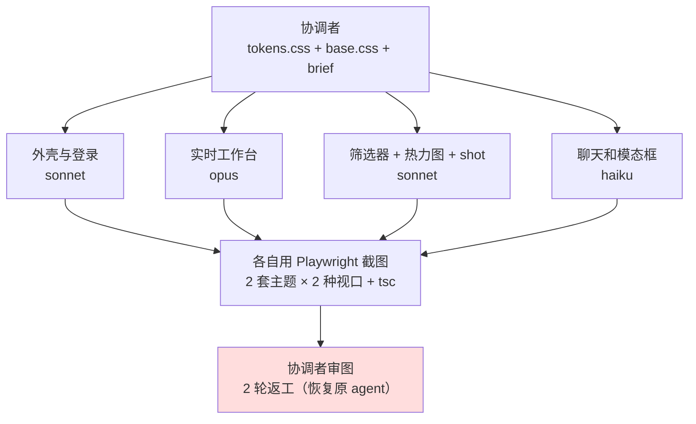

# PriceAction-AB 的 Quiet Desk 改版：4 个并行 agent 与实际踩坑

PriceAction-AB 是交易工作台 [[zh/Glossary/SPA|SPA]]，这次重做全站视觉。技术栈是 React 配原生 CSS 自定义属性，不用 Tailwind，每个面板各有一份 CSS，token 全从 `tokens.css` 来。协调者（主会话）先冻结基础层，再派 4 个 subagent 按文件归属拆分面板并行改。

## 背景与约束

- 硬约束是不用 Tailwind 和 CSS-in-JS，沿用每个面板一份 CSS、`tokens.css` 管全部 token 的结构。这是高密度交易台，不是营销页。
- 需求是用 Quiet Desk 这套设计语言统一视觉。第二轮还有功能改动：NY 时区坐标轴、持仓看板、watchlist v2 和 BYO-LLM。
- 协调者先重写 `web/src/styles/tokens.css`（两套主题）、`web/src/styles/base.css` 和 `web/index.html` 的字体加载，冻结为基础层；再写 `docs/design/quiet-desk-brief.md`，作为所有 agent 都读的同一份规格，最后才派 subagent。这个先后顺序本身就是设计决定：不先冻结基础层，4 个 agent 各自发挥 token 用法，视觉合不到一起。

## 候选方案

### 方案 A：单个 agent 依次改面板

- 做法：同一会话按顺序把面板改完。
- 好处：不会有 agent 冲突，也不用划文件归属。
- 代价：面板多（shell/login、live workstation、screener/heatmap/shot、chat/modals），串行会拉长耗时，协调者退化成包办全局的大 agent，失去了并行的意义。

### 方案 B：4 个 agent 并行，各自负责互不重叠的文件（采用）

- 做法：shell/login 给 sonnet，live workstation 给 opus（图表逻辑最重），screener + heatmap + shot 给 sonnet，chat + modals 给 haiku（界面最轻）。四组文件互不重叠。
- 好处：4 倍并行度，每组职责单一，好审查。
- 代价：文件归属只能管「谁写哪个文件」，管不了「谁用了谁的 class」。分段控件这类共享 CSS class 一跨归属边界，就没有天然把关人。这个代价后来酿成了真实 bug（见下文 Bug 4）。

## 决定

选方案 B，配两条措施压住拆分代价：

1. **每个 agent 自验。** 改完自己名下的文件后，用 Playwright 截浅色和深色主题的 1600x950（桌面）与 390x844（手机）截图，跑过 `npx tsc --noEmit`，自己看完再报完工。
2. **协调者集中审图，有问题直接打回。** 截图齐了并排比对，发现毛病就恢复原 agent 带着上下文返工，不用重起新会话。一共返工了 2 轮。

## Quiet Desk 设计语言

规格写在 `docs/design/quiet-desk-brief.md`，4 个 agent 照着实现：

- **底色和卡片**：中性底色（`--bg`）放白色卡片（`--panel` / `--border`），12px 圆角（`--radius`），柔和墨色阴影，面板之间留呼吸感，不用生硬的 1px 边框把满幅面板焊在一起。
- **主按钮用炭灰，交互用靛蓝**：主操作用炭灰胶囊按钮（`--primary`）；靛蓝（`--accent`）只留给链接、焦点态、选中态和 20-EMA 线；紫色（`--mentor`）专给 AI mentor 用，包括聊天气泡和分析流强调色，别处一律不借用。
- **字体层级**：UI 正文用 Inter，数字、价格、时间戳和 ticker 一律用 IBM Plex Mono。Instrument Serif 克制使用，只给登录大标题和每个面板最多一行空状态文案，面板标题和按钮一律不用它。
- **磨砂玻璃只给浮层**：用 `backdrop-filter: blur(16px) saturate(1.4)`，每处都带 `@supports not (backdrop-filter: blur(1px))` 回退（`web/src/styles/chat.css:82-88`、`web/src/styles/live.css:141-146`、`web/src/styles/modals.css:90-94`）。

## 文件归属



支持平移缩放、浅色深色切换和 PNG/SVG 导出的独立版本：[2026-07-10-quiet-desk-redesign-four-parallel-agents.html](../../../Cases/Design/2026-07-10-quiet-desk-redesign-four-parallel-agents.html)

## 第二轮功能改动

- **NY 时区轴**：`lightweight-charts` 内部按 UTC 画刻度，原始数据不做时区转换，只在展示层用 `Intl.DateTimeFormat({ timeZone: 'America/New_York' })` 格式化。`localization.timeFormatter` 和 `timeScale.tickMarkFormatter` 都支持自定义 formatter，定义在 `web/src/components/Chart.tsx:79`，接在 `:136` 和 `:138`。
- **热力图面板改成持仓看板**：新增 `GET /api/spark`（`server/routes/public.js:69`）代理 Yahoo 日收盘价，内存缓存 `SPARK_TTL_MS = 10 * 60_000`（`server/routes/public.js:18`），单次最多查 40 个 symbol（`:70` 的 `.slice(0, 40)`）。客户端根据 `entry_record` 算等权 P&L% 曲线。
- **Watchlist v2**：ticker 图标从 `raw.githubusercontent.com/nvstly/icons` 拉，拉不到退回首字母图标。新增 symbol 走 quotes 端点校验，也能一键加 `/api/picks` 里 AI 推荐的标的。
- 移除 DS-flash/DS-pro 分段控件，现在只剩 pro 档位，没什么可切。
- **BYO-LLM**（自带 LLM provider）：`SettingsModal` 写 `localStorage['ab-llm-custom']`，`/api/chat` 接 `llm` 覆盖字段，`server/llm.js:40` 的 `sanitizeLlmOverride` 负责校验清理，`server/routes/chat.js:165-166` 加 `POST /api/llm-test` 探针端点。故意拿错 key 测试再 grep 服务端日志，确认没把 key 打进日志。

## Bug 与诊断

### Bug 1：图表 canvas 没跟着切深色

现象：切深色主题后，页面其余部分都变暗了，图表的 K 线、网格和水印却还停在浅色配色。

根因：`ThemeContext` 在自己的 `useEffect` 里改 `document.documentElement` 的 `data-theme`。React 先跑子组件 effect，`Chart.tsx` 的 effect 读到的是切换前的旧值。

修复：在 `web/src/components/Chart.tsx:41`，`readPalette()` 先自己幂等调一次 `setAttribute('data-theme', theme)`，再去调 `getComputedStyle`，不再依赖 `ThemeContext` 的 effect 顺序。

### Bug 2：热力图色块撑满整行

现象：某个板块只有 1 只股票时，色块横拉满整行，乍看像渲染坏了。

根因：`.heat-tile { flex: 1 1 120px }` 没设 `max-width`，一行色块少时 flex-grow 把多余空间全分给了它。

修复：加 `max-width`，再按涨跌幅比例分 flex-grow。第二轮固定高度、账簿式布局的持仓看板后来整个替掉了它，见 `web/src/styles/heatmap.css`。

### Bug 3：图表空状态卡片内残留细线

现象：图表无数据时，空状态卡片里还能看到几条本不该出现的细线。

根因：`lightweight-charts` 维护自己的多层 canvas，各自独立堆叠。轴刻度和水印在更靠后的 DOM 位置绘制，压过了后加的、没设 `z-index` 的空状态浮层。

修复：给 `.chart-empty` 加 `z-index: 2` 和背景色，见 `web/src/styles/live.css:101`。

### Bug 4：跨文件归属边界误删共享 CSS（值得记住的教训）

现象：热力图面板的模式切换器变成了挤在一起、没样式的方块。

诊断：live workstation 的 agent 移掉模型切换控件时，把自己负责的 `live.css` 里的 `.seg-ctrl` / `.seg-btn` 当死代码删了。但另一位 agent 负责的 `SectorHeatmap.tsx` 还在用这两个 class。`heatmap.css` 里只有覆写（`.heat-toolbar .seg-ctrl`、`.heat-toolbar .seg-btn`），基础规则一删，覆写没了落脚点，切换器样式全丢。

根因：==判「死代码」时只 grep 了自己名下的文件，没搜全仓库==。文件归属能管「谁写哪个文件」，管不了「谁用哪个 class」，共享 UI 样式跨了归属边界就没有天然的把关人。

修复：协调者把分段控件的基础规则搬进各面板共用的 `base.css`（`web/src/styles/base.css:43-51`），`heatmap.css` 在 `:62-63` 只留覆写。

### Bug 5：一键加 watchlist 时前缀重复

现象：从 `/api/picks` 一键添 symbol，watchlist key 变成了 `NASDAQ:NASDAQ:AAPL`。

根因：`/api/picks` 返回的 symbol 有时已经带了 `EXCHANGE:TICKER`，Watchlist 那边还无条件往前拼 `NASDAQ:`。

修复：不含 `:` 时才补前缀，见 `web/src/components/Watchlist.tsx:211`（`` sym.includes(':') ? sym : `NASDAQ:${sym}` ``）。

### Bug 6：SessionRibbon 游标标签错位 1px

现象：交易时段进度条上的当前时间标签，看得出比所属阶段色带高。

诊断：用 `getBoundingClientRect()` 量，标签 `y=63`，色带 `y=64`，差 1px。

根因：`.ribbon-cursor-label` 写了 `top: -1px`，比色带提前 2px 起画。

修复：改成 `top: 1px`，见 `web/src/styles/ribbon.css:115`。

## 未做事项（YAGNI）

- 没上 Percy、Chromatic 这类自动视觉回归工具。验收靠协调者手工对比 Playwright 截图；4 个 agent、2 轮返工的体量下，人工比对成本足够低，引入工具不划算。
- 没建跨 agent 的共享 class 清单，也没写 lint 规则。踩坑后定下的是约定（「共用样式放共享文件」），暂时没有工具强制执行。

## 经验

- ==多 agent 按文件归属拆活时，判死代码必须 grep 全仓库，只搜自己负责的文件不够。== 分段控件这类跨面板复用的 UI 样式，一开始就该进共享层（`base.css`），留在某个 agent 私有文件里很容易误删。已提炼到 [[zh/Agents/multi-agent-dead-code-deletion-needs-repo-wide-grep|multi-agent-dead-code-deletion-needs-repo-wide-grep]]。
- 协调者要在派 subagent 前先冻结基础层（token、基础样式、字体），写进大家都读的同一份规格（`quiet-desk-brief.md`），不然并行改下来细节自然会走岔。
- subagent 自验要覆盖实际会变的维度。这次盖住了 2 套主题 × 2 种视口加类型检查，漏掉的跨文件 class 依赖正好成了 Bug 4 的盲区。
- `lightweight-charts` 这类 canvas 渲染库不认 CSS 自定义属性，得在 JS 里用 `getComputedStyle` 读出 token 手动传进去。它们还管着多层独立堆叠的 canvas，很容易碰上层级意外（Bug 1 和 Bug 3 都属这类）。

## 验证

`npx tsc --noEmit` 零报错，`vite build` 通过，Playwright e2e 7/7 通过。其中两条断言因为这次主动删了对应功能而重写（模型分段控件、旧 watchlist 切换 class），不是回归。一共 9 个符合 Conventional Commits 的提交：

```
7a5962b docs(design): add quiet desk redesign brief
0ac290d feat(web): quiet desk design tokens, fonts, and shared base styles
af0dec9 feat(llm): custom provider override with settings modal and /api/llm-test
cf9701e feat(web): redesign shell navigation and login brand moment
b75ee42 feat(api): add /api/spark yahoo daily-close proxy for portfolio curve
b9a2511 feat(web): portfolio dashboard with equity curve, redesign screener and shot panes
de44969 feat(web): redesign live workstation, NY time axis, watchlist v2 with icons and AI add
1f8f3dc feat(web): frosted chat widget and overlay modals redesign
1e4c390 test(e2e): cover settings modal and watchlist drawer, drop removed model toggle
```

## 相关

- [[zh/Agents/multi-agent-dead-code-deletion-needs-repo-wide-grep|multi-agent-dead-code-deletion-needs-repo-wide-grep]]
- [[zh/Glossary/SPA|SPA]]
- [[zh/Glossary/TTL|TTL]]
- [[zh/Glossary/e2e|e2e]]
- [[zh/Glossary/LLM|LLM]]
