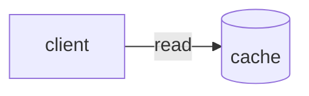

# Widget cache goes stale

The widget showed old data after a refresh; see [[retry-with-backoff]] and [[ETag|entity tag]] for background. Replace <file> with the path.

## Root cause

==The cache key ignored the `locale` field== so every locale shared one entry. A missing link: [[not-written-yet]].

```bash
echo "[[ETag]] and ==not a highlight== stay as typed <id>"
```

Inline `[[ETag]]` and `==x==` stay literal too.



### Fix steps

| Step | Note |
|---|---|
| 1 | see [[ETag]] |


